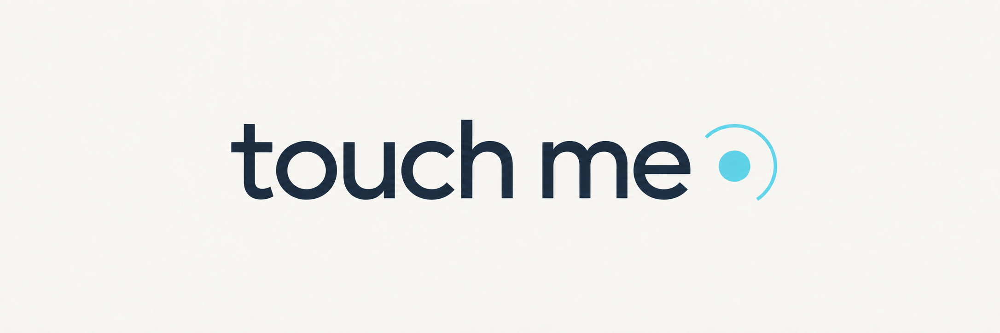
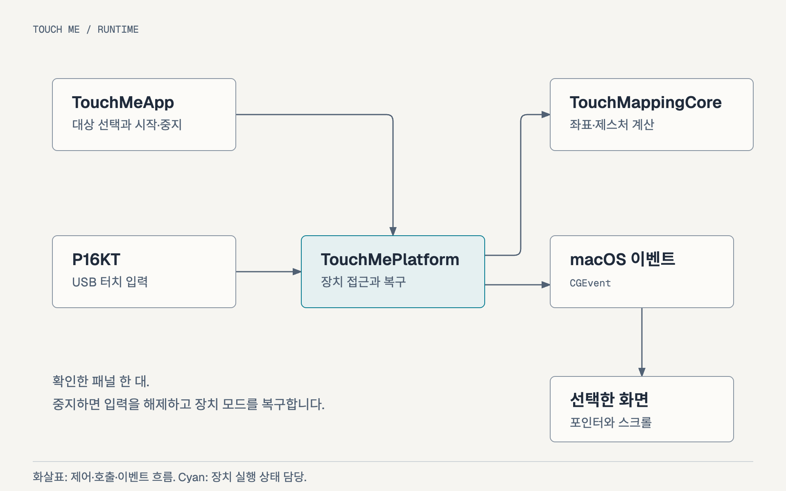

[English](README.md) · [한국어](README.ko.md) · [개발 Workflow](Workflow.ko.md) · [Homebrew 배포](docs/Homebrew.ko.md)

<!-- meta.contentType: Landing; audience: ZEUSLAP owners with the verified P16KT profile; goal: install and operate Touch Me; content plan: purpose, current scope, installation, gestures, recovery, documentation, validation, license. -->

# 맥에서도 ZEUSLAP 터치 모니터 쓰기

Touch Me는 ZEUSLAP 터치 모니터를 Mac에서 활용할 수 있도록 만든 macOS 메뉴 막대 앱입니다. MacBook을 비롯한 Mac에서 터치 입력이 제대로 작동하지 않는 문제를 해결하고, 화면을 손가락으로 직접 조작할 수 있도록 돕는 것이 목적입니다.

터치 입력을 선택한 화면의 좌표에 맞춰 전달해 탭과 더블 클릭, 한 손가락 드래그, 두 손가락 스크롤·핀치와 세 손가락 화면 전환을 사용할 수 있습니다. 앱에서 대상 화면을 선택하고 확인한 뒤 매핑을 시작하며, 메뉴 막대에서 매핑을 중지하거나 설정을 바꿀 수 있습니다.

Beta `0.8.0-beta.11`은 **P16KT에서 확인한 USB/HID profile**을 요구합니다. 장치 식별자와 HID(Human Interface Device) 입력 구조가 다르면 매핑을 시작하지 않습니다. 다른 ZEUSLAP 모델까지 지원한다고 보장하지 않으므로 아래 환경을 먼저 확인해 주세요.

[Beta.11/build 33](https://github.com/soom-kang/touch-me/releases/tag/v0.8.0-beta.11)과
Homebrew Cask를 2026-10-25에 공개했습니다. 핀치 확대·축소와 세 손가락 Mission
Control·Space 전환을 지원합니다. 공개 DMG·checksum과 Tap 파일을 대조했습니다.
실기 결과는 개발 build 32에서 확인한 범위이며, 새 build 33의 설치·upgrade는
**NOT_RUN**입니다. [Beta.11 검증 기록](docs/releases/v0.8.0-beta.11.md)을 확인하세요.

이전 공개·upgrade 기록:

[Beta.10/build 28](https://github.com/soom-kang/touch-me/releases/tag/v0.8.0-beta.10)은
**PUBLISHED**입니다. 공개 시각은 2026-10-14 01:14:28 KST
(2026-10-13 16:14:28 UTC)입니다. 공개 DMG·checksum과 release source/tag의
입력 43개를 대조했습니다. Tap Cask 공개 revision은 `27fd12ee`입니다.
정상 Homebrew beta.9 → beta.10 in-place upgrade 한 번에서 설치 파일·strict
인증서/DR·바깥 디렉터리와 기존 환경설정·복구 상태 보존을 확인했습니다.
사용자가 재승인 없이 B10 GUI의 두 권한 모두 Allowed임을 확인했습니다.
**PASS_USER_REPORTED_ON_THIS_MAC**이며 native process 식별도 확인했습니다.
[Beta.10 release notes](docs/releases/v0.8.0-beta.10.md)를 확인하세요.

Beta.9는 최초 ad hoc → 장기 인증서 전환의 A baseline입니다. 사용자가 두 권한
모두 Allowed임을 확인한 뒤 정상 Quit했고 native PID 부재도 확인했습니다.
[Beta.9 checkpoint](docs/releases/v0.8.0-beta.9.md)는 별도로 보존합니다.

2026-10-12 공개 checkpoint: [Beta.8/build 26](https://github.com/soom-kang/touch-me/releases/tag/v0.8.0-beta.8)을 2026-10-12 10:41:21 KST(01:41:21 UTC)에 **PUBLISHED**로 공개했습니다. 공개 DMG/checksum bytes는 검사한 release와 일치하며 공개·로컬 Tap revision `47a3e433`도 검증한 Cask와 같습니다. 새 앱과 DMG를 각각 한 번 생성하고 native 산출물 검사를 통과했습니다. 기존 Swift 38개와 packaging 22개 PASS는 재사용합니다. Build 26 GUI·실기기 사용·설치·Homebrew upgrade·Gatekeeper는 `NOT_RUN`입니다. [Beta.8 release notes](docs/releases/v0.8.0-beta.8.md)를 확인하세요.

공개 beta.8에는 아래에서 설명하는 TMQA-006 복구 기록 정리와 TMQA-007 패키징 수정을 포함합니다. 기존 arm64/macOS 26+ 대상, ad hoc 서명과 장치 모드 및 환경설정 형식은 유지합니다.

합의한 범위에 따라 online audit는 계속 `BLOCKED`입니다. Trust·developer 변경 명령이나 우회 변수는 사용하지 않았습니다. 대상 trust 상태는 baseline과 같으며 공유 store의 [관측 한계](docs/releases/v0.8.0-beta.8.md#상태-보존과-관측-한계)는 별도로 기록합니다.

2026-10-10 공개 checkpoint: [beta.7/build 25](https://github.com/soom-kang/touch-me/releases/tag/v0.8.0-beta.7)를 14:25:14 KST(05:25:14 UTC)에 **PUBLISHED**로 공개했습니다. 당시 익명 public DMG/sidecar의 bytes와 hash는 동결한 release와 일치했고 공개 Tap과 로컬 Tap revision도 검토한 Cask와 일치했습니다. Swift tests 37개와 개발 build 24의 재연결 cycle 한 번을 재사용했으며 build 25 설치, GUI, 실기기 사용, Gatekeeper와 Homebrew upgrade는 `NOT_RUN`이었습니다. 과거 산출물 식별과 결과는 [beta.7 release notes](docs/releases/v0.8.0-beta.7.md)에 보존합니다.

2026-10-09 공개 기록: QA 완료 문서를 포함한 [beta.6 build 24](https://github.com/soom-kang/touch-me/releases/tag/v0.8.0-beta.6)를 공개했고 당시 beta.5 이후 실행 코드 변경은 없었습니다. Public DMG·checksum, Tap과 online audit 검사는 통과했고 산출물 식별은 [release notes](docs/releases/v0.8.0-beta.6.md)에 있습니다. [Beta.5 build 23 acceptance](docs/qa/beta5-native-acceptance.md)는 회귀 근거로만 인용합니다. 2026-10-09 공개 checkpoint에서 beta.6 설치·GUI·Gatekeeper·실기기 사용·Homebrew upgrade는 `NOT_RUN`이었으며 당시 설치된 beta.5 앱을 보존했습니다.

## Source QA checkpoint — 2026-10-12

[Source QA 보고서](docs/qa/2026-10-12-qa-report.md)에 commit `f828fd22`의
TMQA-006/007 수정 결과를 기록했습니다. Active record가 없어도 재시도와 Start 전에
저장소 sync를 확인합니다. 패키징은 staging에서 완전한 DMG/checksum 쌍을
준비하고 유효한 이전 쌍을 함께 보관합니다. 일반 파일 이동 오류는 rollback하며
rollback도 실패하면 추가 이동을 중단하고 복구할 경로를 표시합니다. 기존 쌍 중 한 파일만
없거나 checksum이 불일치하면 그대로 보존하고 중단합니다. 두 파일이 모두 없으면
첫 패키징을 허용합니다. 개별 파일 이동은
crash, power-loss나 concurrent-run atomicity를 보장하지 않습니다.

Beta.8 준비 전에는 로컬 QA 앱과 DMG 각 1개가 native 서명, 이미지 검사와 읽기 전용
inner-app 비교를 통과했습니다. 이 [로컬 native build snapshot](docs/qa/2026-10-12-native-build.md)은
beta.7/build 25로 표시되지만 공개 beta.7과 hash가 다릅니다. 해당 산출물 검사로
새 beta.8/build 26을 검증했다고 볼 수 없습니다. 공개 beta.7과 설치 앱은 보존하며
새 GUI/실기기 acceptance를 주장하지 않습니다.

## 먼저 사용 환경을 확인하세요

Apple Silicon Mac에서 P16KT 한 대를 연결하는 환경을 대상으로 합니다. 실기기에서 확인한 조합은 Apple M4 Max, macOS 26.7.1과 USB-C 직접 연결입니다:

| 항목 | 현재 범위 |
| --- | --- |
| Mac | Apple Silicon(arm64), macOS 26 이상 |
| 터치 패널 | ZEUSLAP P16KT 한 대; USB 장치 `0x0457:0x0819` |
| 대상 화면 | 회전과 미러링을 사용하지 않는 외부 화면 |
| 권한 | 입력 모니터링과 손쉬운 사용 |
| 앱 언어 | 기본값 영어; 설정에서 English / 한국어 선택 |
| 배포 | 인증서 서명 앱을 DMG로 배포; 개인 Homebrew beta Tap |

다른 패널, Intel Mac과 이전 macOS 버전은 검증 기록이 없습니다. Touch Me를 열기 전에 다른 터치 매핑 프로그램을 중지하세요.

## 설치하고 첫 매핑 시작하기

공개한 beta.11/build 33을 Homebrew로 설치하거나 DMG에서 복사할 수 있습니다. 어느 쪽으로 설치하든 권한과 대상 화면 설정은 같습니다.

### Homebrew로 설치하기

수동 설치한 `/Applications/Touch Me.app`이 이미 있다면 **로그인 시 Touch Me 열기**를 끄고 **매핑 중지**를 선택하세요. 연속 연결의 모드 복구나 종료가 확인된 연결의 기록 보존을 확인한 뒤 정상 종료하고 기존 앱을 Applications 밖으로 옮겨 보존하세요. 복구에 실패하면 설치를 멈추세요. 강제 덮어쓰기 없이 기존 앱과 환경설정을 보존하는 방법은 [Homebrew 설치 안내](docs/Homebrew.ko.md#공개-후-설치업데이트제거)에 정리했습니다.

Tap의 Cask가 공개 beta.11 산출물과 checksum을 가리키는지 확인한 뒤 설치하세요:

```bash
brew install --cask soom-kang/touch-me/touch-me
```

### DMG로 설치하기

[beta.11 release](https://github.com/soom-kang/touch-me/releases/tag/v0.8.0-beta.11)에서 `touch-me-0.8.0-beta.11-arm64.dmg`와 `.sha256` 파일을 받으세요. Version/build `0.8.0-beta.11`/33, [release notes](docs/releases/v0.8.0-beta.11.md)의 checksum과 인증서 fingerprint를 확인한 뒤 이미지를 열어 **Touch Me.app**을 **Applications**로 복사하세요. 복사를 마치면 이미지를 추출합니다. 이전 로컬 QA·서명 후보는 별도 산출물입니다.

Beta는 maintainer self-signed 인증서로 서명했으며 Developer ID와 공증은 없습니다. 인증서 trust를 추가하지 마세요. macOS가 다운로드한 앱의 첫 실행을 차단하면 출처와 checksum을 확인한 뒤 [Apple의 수동 실행 승인 안내](https://support.apple.com/en-us/102445)를 따르세요. 승인 항목이 보이더라도 앱 실행을 보장하지는 않습니다.

### 권한과 대상 화면 맞추기

설치한 앱을 열고 메뉴 막대의 **Settings / Proof**(**설정 / 시험**)를 여세요. 저장한 언어 선택이 없으면 영어로 시작합니다. 상단의 **Language / 언어**에서 **English** 또는 **한국어**를 선택하세요.

선택한 언어는 바로 적용되고 다음 실행에도 유지됩니다. 언어를 바꿔도 실행 중인 매핑, 선택한 대상과 시험 기록은 그대로이며 macOS 대화상자는 자체 언어를 따릅니다.

다음 순서로 권한과 대상 화면을 설정하세요:

1. **시스템 설정 → 개인정보 보호 및 보안**의 **입력 모니터링**과 **손쉬운 사용**에서 필요한 Touch Me 항목만 허용하세요. 이미 허용된 항목은 유지합니다.
2. P16KT를 USB-C로 연결하세요. 권한이나 장치가 보이지 않으면 **다시 조회**를 누르세요.
3. P16KT 화면을 선택하고 **선택 화면에서 시험 창 열기**를 누르세요.
4. 시험 창이 P16KT에 나타나는지 확인한 뒤 **시험 창이 P16KT에 표시되는 것을 확인했습니다**를 선택하세요.
5. **매핑 시작**을 누르고 서로 떨어진 두 위치에서 탭 좌표를 확인하세요.

설정 창을 닫아도 앱은 메뉴 막대에 남고 매핑은 계속됩니다.

## 손가락으로 사용하기

Beta.11부터 핀치 확대·축소와 세 손가락 전환을 지원합니다. 자동 검사는 통과했습니다.
로컬 build 32에서 사용자가 P16KT로 다음 동작을 정상 확인했습니다.

- 세 손가락 연속 동작과 양쪽 Space 경계·복귀
- Safari와 Chrome의 핀치 확대·축소
- Preview의 PDF·이미지 핀치 확대·축소
- 핀치 중 Stop과 매핑 재시작 후 새 입력
- 핀치 중 잠금과 해제 후 자동 재개·새 입력
- 핀치 중 USB 분리와 같은 포트 재연결 후 자동 재개·새 입력
- 현재 모니터 4대 배치에서 P16KT 입력 대상과 최종 중지

이 결과는 macOS 26.7.1을 사용하는 현재 Mac과 화면 배치에 한정합니다.
[제스처 QA 기록](docs/qa/automated-tests.md#gesture-expansion--2026-10-25)에서 검증 범위를 확인하세요.

다음 제스처를 사용할 수 있습니다.

| 동작 | 제스처 |
| --- | --- |
| 클릭 또는 더블 클릭 | 한 번 또는 두 번 탭하며, 각 클릭은 손가락을 뗄 때 발생 |
| 드래그 | 한 손가락을 처음 위치에서 화면 좌표 8단위보다 멀리 이동 |
| 세로 또는 가로 스크롤 | 드래그가 시작되기 전에 두 손가락을 대고 함께 이동하며, 클릭은 발생하지 않음 |
| 앱 콘텐츠 확대·축소 | 두 손가락을 벌리거나 오므림. ‘두 손가락 핀치 확대·축소’ 설정과 호환 앱이 필요함 |
| Mission Control | 세 손가락을 위로 충분히 밀면 한 번 실행 |
| 다음 / 이전 데스크탑 또는 전체 화면 앱 | 세 손가락을 왼쪽 / 오른쪽으로 충분히 밀면 한 번 전환 |
| 드래그 중 두 번째 손가락 추가 | 드래그는 처음 손가락을 계속 따라감 |
| 드래그 중 세 번째 손가락 추가 | 드래그를 해제함. 손가락을 모두 뗀 뒤 다시 시작 |
| 제스처 전환 | 손가락을 모두 뗀 뒤 새 제스처 시작 |

스크롤과 핀치는 움직임이 명확해지면 해당 동작으로 고정됩니다. 확정 전에 세 번째
손가락을 대면 세 손가락 동작으로 시작할 수 있지만, 확정 후에 추가하면 취소합니다.
남은 손가락으로 클릭하거나 드래그할 수 없으며, 네 손가락 이상도 입력을 취소합니다.
다시 시작하려면 손가락을 모두 떼세요.

핀치는 macOS 26에서 이벤트 형식 검사에 통과하면 기본으로 활성화됩니다.
설정에서 핀치를 꺼도 스크롤은 계속 사용할 수 있습니다. 비공개 macOS 이벤트 형식을
사용하므로 다른 macOS major 버전이거나 형식 검사에 실패하면 이유를 표시하고
핀치를 비활성화합니다. 키보드 확대 단축키로 대체하거나 화면 전체를 확대하지 않습니다.
확대할 콘텐츠 위에서 사용하세요. Touch Me가 다른 앱을 클릭하거나 활성화하지는
않으며, 확대·축소 처리 방식은 앱마다 다를 수 있습니다.

세 손가락 전환에는 macOS ‘키보드 단축키 → Mission Control’의 기본
**Control+↑/←/→** 단축키가 필요합니다. Touch Me는 이 설정을 변경하지 않습니다.
modifier 키와 마우스 버튼에서 손을 뗀 뒤 사용하세요. Space 전환 범위는 macOS의
‘각각의 Spaces가 있는 디스플레이’ 설정을 따르며, 화면이 손가락을 따라 움직이는
애니메이션을 합성하지 않습니다.

### 로컬 개발 후보: 뒤로 가기와 앞으로 가기

미공개 로컬 소스에 두 손가락 페이지 쓸어넘기기를 추가했습니다. 공개 beta.11/build
33과 Homebrew Cask에는 아직 포함되지 않은 기능입니다.
후보를 설치하거나 공개하지 않았습니다.

- 두 손가락을 오른쪽으로 밀면 뒤로, 왼쪽으로 밀면 앞으로 갑니다. macOS의
  **자연스러운 스크롤** 설정에 따라 직접 터치 방향을 반전하지 않습니다.
- 콘텐츠를 스크롤할지 방문 기록을 이동할지는 입력을 받은 앱이 판단합니다.
  짧게 밀었다가 손을 떼기 전에 되돌리면 앱의 전환을 취소할 수 있습니다.
- macOS **페이지 쓸어넘기기**에서 두 손가락 동작을 활성화하세요. Touch Me가
  설정을 변경하거나 키보드 탐색 단축키로 대체하지 않습니다.
- 페이지 쓸어넘기기는 비공개 macOS 제스처 형식을 사용하며, macOS 26에서
  형식 검사에 통과할 때 활성화됩니다. 다른 macOS major 버전이나 검사 실패 시에도
  일반 스크롤은 사용할 수 있습니다. 핀치를 꺼도 페이지 쓸어넘기기는 유지됩니다.

2026-10-28에 사용자가 P16KT와 macOS 26.7.2에서 로컬 build 36의 기본 동작을
확인했습니다(**PASS_USER_REPORTED**). Safari 27.2와 Chrome 156.0.8078.74에서
손가락을 따라가는 뒤로·앞으로 전환, 반복 동작과 되돌려 취소하기가 정상입니다.
두 브라우저에서 다음도 정상으로 확인했습니다.

- 방문 기록의 처음·마지막 경계와 손을 뗀 뒤 반대 방향 복귀
- 원치 않는 페이지 전환·클릭 없는 세로·대각선 스크롤, 핀치, 탭과 텍스트 선택 드래그

두 브라우저에서 가로로 긴 페이지의 스크롤과 양쪽 경계도 내장 트랙패드와 같은
동작으로 확인했습니다. build 36의 USB 시험에서 새 입력이 작동하지 않아 build 38에서
접점 소스 선택을 수정했습니다. 이후 두 브라우저의 USB 복구와 새 입력, 핀치·드래그·
되돌려 취소하기를 정상으로 확인했습니다(**PASS_USER_REPORTED**).
build 38의 세 손가락 연속 동작, 현재 다중 화면 배치에서 P16KT 대상 적용과 최종
중지도 정상입니다. build 36의 브라우저 검증과 build 38의 집중 회귀 검증으로 합의한
로컬 검증 범위를 마쳤습니다. build 36의 전체 검증표를 build 38에서 반복한 것은
아닙니다. 선택 항목인 자연스러운 스크롤 켜기·끄기 비교는 **NOT_RUN**이며 설정을
바꾸지 않았습니다. 정확한 후보 식별과 결과는 [페이지 쓸어넘기기 QA 기록](docs/qa/automated-tests.md#native-page-swipe-candidate--2026-10-28)에 있습니다.

## 중지하고 다시 시작하기

메뉴의 **매핑 중지**를 선택하면 입력을 해제하고 다음 실행에서도 중지 상태를 유지합니다. 매핑 중 정상 종료하면 다시 시작할 의도를 저장합니다. 자동 재개하려면 저장한 화면과 USB 위치가 일치하고 두 권한이 모두 허용돼야 합니다.

앱은 화면 잠금, 절전이나 사용자 세션 비활성화로 매핑을 잠시 중지해도 재개할 의도를 보존합니다. 돌아오면 저장한 패널·USB 위치·화면과 권한을 다시 확인한 뒤 매핑을 시작합니다. 준비 확인은 10초의 재시도 구간 안에서 진행하며, 이미 실행 중인 장치 호출은 더 오래 걸릴 수 있습니다. 복구 구간이 만료되면 직접 시작해야 합니다. 실제 중단을 확인한 경우에는 첫 재개 후에도 같은 복구 구간을 유지합니다. 그 안에서 일시적인 대상 변경이 발생하면 원래 화면 구성과 저장한 장치가 다시 일치할 때만 재시도하며, 재시도로 복구 시간을 연장하지 않습니다. **매핑 중지**, 다른 매핑 오류와 복구 구간 밖의 별도 대상 변경은 자동 재개를 취소합니다. 장치 모드 복구 오류가 있으면 먼저 **복구 재시도**를 수행해야 합니다.

**로그인 시 Touch Me 열기**는 기본값이 꺼짐입니다. 앱을 Applications에 설치한 뒤 설정에서 켤 수 있습니다. 이 옵션은 로그인할 때 앱을 여는 설정이고 매핑 재개 여부는 저장한 실행 상태에 따릅니다.

## USB-C 재연결

이 동작은 beta.7부터 포함됐습니다. 2026-10-10에 사용자가 개발 build 24의 cycle 한 번을 확인했습니다: 시작 → USB-C 분리 → 재연결 → 자동 재개 → 두 위치 탭 → 중지(`PASS_USER_REPORTED`). 검증한 실행 파일 hash와 별도로 승인한 기존 앱 전환은 [Workflow](Workflow.ko.md#usb-c-재연결-후보--2026-10-10)에 보존합니다. 이 결과는 과거 회귀 근거입니다. Beta.8은 복구 기록 정리를 변경하며 새 build 26의 실기기 acceptance는 없습니다. 당시 cycle에서 모드 직접 읽기나 다른 복구 조건은 검증하지 않았습니다.

앱이 열린 상태에서 매핑 중인 패널을 분리하면 입력을 해제하고 **재연결 대기** 상태로 바뀝니다. 지원하는 P16KT 한 대를 저장한 USB 위치와 화면에 다시 연결하세요. 앱은 권한, 세션 상태, descriptor와 현재 화면 좌표를 확인한 뒤 재개합니다. 장치가 처음 다시 나타난 시점부터 10초 동안 1초 간격으로 재시도하며 중복 알림으로 시간을 늘리지 않습니다. **중지**, 대상 선택 변경이나 **정상 종료**는 대기를 취소합니다.

장치를 독점으로 연 뒤 새로 읽은 모드가 `(0,0)`일 때만 자동 시작합니다. 새 연결이 이미 `(2,0)`이면 안내를 확인하고 **매핑 시작**을 직접 누르세요. 이때는 중지 후에도 현재 모드를 유지합니다. 이전 연결의 모드 값을 새 연결에 쓰지 않습니다.

같은 부팅과 소유자 조건을 확인하고 기록된 HID와 USB 서비스가 모두 종료됐음을 확인해야 이전 기록을 보존용으로 옮깁니다. 이는 원래 모드 복구를 확인하지 못했다는 기록입니다. 처음부터 `(2,0)`인 세션은 모드 변경 기록이 없지만, 당시 읽은 원래 값으로 재연결 확인 기록을 남깁니다. 이 기록으로 재실행 후에도 새 모드 확인 조건을 유지하며 완료 전 케이블 대기 의도를 저장하지는 않습니다. 식별, 소유자나 기록 처리가 불확실하면 시작을 차단하고 오류를 표시합니다. 자세한 내용은 [lifecycle 정책](docs/qa/lifecycle-policy.md)과 [기록 처리 계약](docs/qa/abnormal-exit-recovery.md)을 확인하세요.

## 오류 복구와 업데이트, 제거

매핑 중에는 확인한 P16KT의 장치 모드를 임시로 변경합니다. 중지하거나 정상 종료하면 입력을 해제하고 확인한 연속 연결에서 변경했던 모드를 원래 값으로 복구합니다. 앱이 연결 종료를 확인한 경우에는 복구 성공으로 판정하지 않고 기록을 보존하며 [기록 처리 계약](docs/qa/abnormal-exit-recovery.md)을 따릅니다. 복구나 archive에 실패하면 앱 종료가 차단될 수 있습니다. 다음 순서로 복구하세요:

| 상황 | 다음 행동 |
| --- | --- |
| 권한이 부족함 | 필요한 Touch Me 항목만 허용하고 기존 허용 항목은 유지한 뒤 **다시 조회**를 누르세요 |
| 패널이나 화면이 바뀜 | 저장한 패널과 대상 화면을 다시 확인하세요. 이전 기록은 연결 종료가 확인돼야 보존용으로 옮깁니다 |
| 매핑 중 케이블을 분리함 | 저장한 대상이 돌아오기를 기다리고 직접 시작 안내가 있으면 따르세요 |
| 장치 접근에 실패함 | 다른 매핑 프로그램을 중지하고 USB 연결을 확인하세요 |
| 장치 모드 복구에 실패함 | 현재 연결을 유지하고 **복구 재시도**를 누르세요. 식별이나 기록 처리가 불확실하면 차단을 유지합니다 |

강제 종료, 충돌이나 전원 손실에서는 정상 정리 절차를 실행할 수 없습니다. 공개 beta.4와 이전 beta.5 build 22는 원래 모드를 프로세스 메모리에만 저장합니다. Build 22는 한 번의 `SIGKILL`과 재실행 → Stop → 정상 Quit 뒤에도 모드 2가 남았고 별도 진단으로 저장한 `(0,0)`을 복구했습니다. 공개 beta.5와 beta.6는 모드 변경 전에 원래 값을 기록하며 이전 소유자의 종료와 같은 부팅·계속 연결된 장치 식별이 확인될 때만 복구합니다. 연결이 바뀌거나 기록이 불확실하면 매핑을 차단하며 같은 포트에 다시 연결해도 복구를 허용하지 않습니다. Build 23은 원래 모드 0·같은 부팅·계속 연결된 P16KT 조건의 SIGKILL·재실행 복구 한 번을 통과했으며 다른 중단 조건은 아직 검증하지 않았습니다.

앱 재실행이나 이후 중지 성공만으로 충돌 전 모드가 복구됐다고 판단하지 마세요. 장치 동작이 예상과 다르면 매핑을 중지하고 업데이트와 제거를 보류하며 오류 내용을 보존하세요. 추측한 모드 값을 장치에 강제로 쓰지 마세요. 자세한 확인 범위는 [비정상 종료 검증](docs/qa/abnormal-exit-recovery.md)에 정리했습니다.

업데이트하거나 제거하기 전에는 **매핑 중지 → 안전한 정리 확인 → 정상 종료**를 수행하세요. 안전한 정리는 연속 연결의 모드 복구나 종료가 확인된 연결의 기록 보존입니다. 복구나 기록 처리에 실패하면 기록과 오류를 보존하고 복구 재시도를 마칠 때까지 진행하지 마세요. 기록을 삭제하거나 이전 모드를 새 연결에 쓰지 않습니다. 업데이트 뒤에는 두 권한의 상태를 확인하고 필요한 항목만 허용하세요.

공개 beta.9·beta.10·beta.11은 같은 장기 인증서로 서명했습니다. 최초 A9 전환 뒤
사용자는 두 권한 모두 Allowed임을 확인했습니다. 정상 beta.9 → beta.10
upgrade는 통과했고 사용자가 재승인 없이 B10의 두 권한 모두 Allowed임을
확인했습니다. 이 Mac의 같은 사용자·설치 경로에서 확인한 권한 유지 PASS이며
GUI 값은 사용자 보고입니다.
서명 identity가 없는 수신 Mac은 미검증입니다.

제거할 때는 **로그인 시 Touch Me 열기**도 꺼 주세요. 직접 설치한 앱은 안전한 정리와 종료를 마친 뒤 휴지통으로 옮기고 Homebrew로 설치한 앱은 [업데이트와 제거 안내](docs/Homebrew.ko.md#공개-후-설치업데이트제거)를 따르세요. 이 절차는 저장한 환경설정을 삭제하지 않습니다.

## 구조와 자세한 문서

앱에서 대상을 선택하고 매핑을 시작하면 Platform 코드가 패널 입력을 읽습니다. Core가 좌표를 변환하고 제스처를 판별하면, Platform이 선택한 화면에 맞춰 마우스·스크롤·핀치·시스템 단축키 이벤트를 전달합니다. 구조도에 표시된 기존 계층을 새 제스처 경로에서도 사용합니다.



직접 빌드하거나 배포 과정을 확인하려면 아래 문서를 참고하세요:

- [개발 Workflow](Workflow.ko.md): 모듈별 역할, 로컬 빌드와 패키징, 변경에 맞는 검증
- [Homebrew 배포](docs/Homebrew.ko.md): Tap과 release 절차, 설치 충돌, 업데이트와 제거
- [beta.11 release notes](docs/releases/v0.8.0-beta.11.md): 제스처 배포 산출물과 검증 범위
- [beta.10 release notes](docs/releases/v0.8.0-beta.10.md): 공개·upgrade와 권한 유지 검증 기록
- [beta.9 release notes](docs/releases/v0.8.0-beta.9.md): 최초 인증서 전환의 허용 baseline
- 과거 release notes: [beta.4](docs/releases/v0.8.0-beta.4.md), [beta.5](docs/releases/v0.8.0-beta.5.md), [beta.6](docs/releases/v0.8.0-beta.6.md), [beta.7](docs/releases/v0.8.0-beta.7.md), [beta.8](docs/releases/v0.8.0-beta.8.md)
- [편집 가능한 구조 다이어그램](docs/assets/architecture.ko.html)

공개 beta.11/build 33 산출물은 `dist/touch-me-0.8.0-beta.11-arm64.dmg`입니다. Native 검사와 public bytes 비교를 통과했고 정확한 source/tag·다운로드 식별은 release notes에 기록합니다. 로컬 빌드 버전은 `VERSION`에서 읽습니다.

## 기록된 검증 결과

2026-10-07(`Asia/Seoul`)의 build 8 단독 검증에서 보존한 결과입니다. 아래 입력 동작은 사용자 보고이며 프로세스와 산출물은 별도로 확인했습니다:

- 탭 좌표, 한 손가락 드래그와 정상 종료 후 입력 해제
- 사전 탭 없는 두 손가락 세로 스크롤과 가로 스크롤
- 더블 클릭 감지와 정상 종료 후 자동 재개
- 중지 상태 유지, 로그인 항목 등록과 해제
- 개인용 DMG의 Finder 설치와 설치 후 매핑

이는 과거 기록이며 beta.3나 재생성한 앱을 새로 실기기에서 검증한 결과가 아닙니다. 실제 로그아웃과 로그인 실행은 `NOT_RUN`, 자동 재개 후 가로 스크롤은 `NOT_RETESTED`입니다. 다른 매핑 프로그램이 개입했을 수 있는 초기 시험은 단독 동작의 근거로 사용하지 않습니다.

2026-10-08에 사용자는 build 18의 잠금·해제 후 로그인하자마자 터치가 정상 작동했다고 확인했습니다. 해당 build에는 beta.3에 포함되는 복구 코드가 들어 있습니다. 한 번의 사용자 확인 결과이며 정확한 복구 시간을 보장하지 않습니다.

beta.3 release 앱을 설치하거나 실기기에서 실행하지는 않았습니다. 해당 release의 Homebrew 설치, Gatekeeper, 절전·복귀와 실제 로그아웃·로그인 검사는 `NOT_RUN`이었습니다.

2026-10-09 제스처 수정 후 기존 Swift 테스트 14개가 모두 통과했습니다. 사용자는 build 20에서 엇갈린 두 손가락 스크롤 중 누름 횟수가 늘지 않고 탭·더블 클릭·드래그와 최초 손가락 추적이 정상이라고 보고했습니다(`PASS_USER_REPORTED`). 실제 이벤트를 직접 관찰한 결과는 아닙니다. beta.4 배포 준비 당시 build 21은 설치하거나 패널에서 실행하지 않았으며, 해당 산출물의 native/device·Homebrew 설치·Gatekeeper 검사는 `NOT_RUN`이었습니다. [개발 Workflow의 검증 기록](Workflow.ko.md#변경에-맞는-최소-검증-선택하기)과 [beta.4 release notes](docs/releases/v0.8.0-beta.4.md)를 확인하세요.

## 라이선스

Touch Me에는 [MIT License](LICENSE)를 적용합니다. 저작권 표기는 2026 Soom Kang입니다. 앱 메뉴의 **라이선스**에서도 읽을 수 있습니다.
