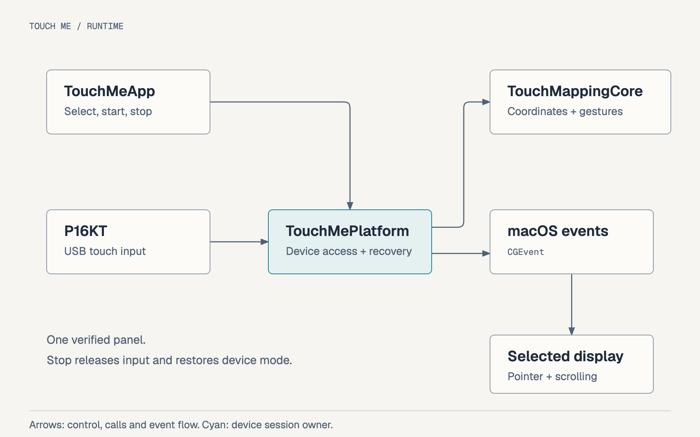

[English](README.md) · [한국어](README.ko.md) · [Build workflow](Workflow.md) · [Homebrew distribution](docs/Homebrew.md)

<!-- meta.contentType: Landing; audience: ZEUSLAP owners with the verified P16KT profile; goal: install and operate Touch Me; content plan: purpose, current scope, installation, gestures, recovery, documentation, validation, license. -->

# Use your ZEUSLAP touchscreen on macOS

Touch Me is a macOS menu bar app built to help you use ZEUSLAP touch-enabled monitors on a Mac. Its purpose is to address touch input that does not work properly on MacBooks and other Macs, helping you interact directly with the screen using your fingers.

It maps touch input to the display you select, enabling taps, double-clicks, one-finger dragging and two-finger scrolling. Choose and confirm the target display in the app, then start mapping. Use the menu bar to stop mapping or change settings.

Beta `0.8.0-beta.10` requires the **USB/HID profile verified on the P16KT**. Mapping won't start if the device identifiers or HID (Human Interface Device) input layout differ. Support for other ZEUSLAP models isn't guaranteed, so check the setup below first.

[Beta.10/build 28](https://github.com/soom-kang/touch-me/releases/tag/v0.8.0-beta.10)
is **PUBLISHED** — 2026-10-14 01:14:28 KST (2026-10-13 16:14:28 UTC).
Public DMG/checksum bytes and all 43 release-source/tag inputs match.
The published Tap Cask revision is `27fd12ee`. One normal Homebrew beta.9 →
beta.10 in-place upgrade passed with installed files, strict certificate/DR,
outer-directory and existing preference/recovery state preservation verified.
The user confirmed both B10 GUI permissions Allowed without reapproval:
**PASS_USER_REPORTED_ON_THIS_MAC**, with native process provenance verified.
See the [beta.10 release notes](docs/releases/v0.8.0-beta.10.md).

Beta.9 is the initial ad hoc → permanent-certificate A baseline. The user
confirmed both permissions Allowed, then normal Quit and native PID absence
passed. Its [beta.9 checkpoint](docs/releases/v0.8.0-beta.9.md) is retained.

Historical 2026-10-12 publication: [Beta.8/build 26](https://github.com/soom-kang/touch-me/releases/tag/v0.8.0-beta.8) was **PUBLISHED** on 2026-10-12 at 10:41:21 KST (01:41:21 UTC). Public DMG/checksum bytes match the inspected release. The public and installed Tap revision `47a3e433` matches the verified Cask. One new app and DMG passed native artifact checks; the existing 38 Swift and 22 packaging test results are reused. Build 26 GUI, real-device use, installation, Homebrew upgrade and Gatekeeper are `NOT_RUN`. See the [beta.8 release notes](docs/releases/v0.8.0-beta.8.md).

Published beta.8 includes the TMQA-006 recovery-cleanup fix and TMQA-007 packaging fix described below. It keeps the arm64/macOS 26+ target, ad hoc signature and existing device-mode and preference formats.

Online audit remains `BLOCKED` under the agreed deferral. No trust/developer modification commands or bypass variables were used. Target trust settings match their baseline; the shared store has a [separate observation limit](docs/releases/v0.8.0-beta.8.md#preserved-state-and-observation-limit).

Historical 2026-10-10 publication: [beta.7/build 25](https://github.com/soom-kang/touch-me/releases/tag/v0.8.0-beta.7) was **PUBLISHED** at 14:25:14 KST (05:25:14 UTC). At that checkpoint, anonymous public DMG/sidecar bytes and hashes matched the frozen release, and public/locally fetched Tap revisions matched the verified Cask. The release reused 37 Swift tests and one development build 24 reconnection cycle; build 25 installation, GUI, real-device use, Gatekeeper and Homebrew upgrade were `NOT_RUN`. See the [beta.7 release notes](docs/releases/v0.8.0-beta.7.md) for the historical artifact identities and results.

Historical 2026-10-09 publication: [beta.6 build 24](https://github.com/soom-kang/touch-me/releases/tag/v0.8.0-beta.6) contained completed QA records with no runtime-code changes since beta.5 at that release. Public DMG/checksum, Tap and online audit checks passed; artifact identities are in the [release notes](docs/releases/v0.8.0-beta.6.md). The [beta.5 build 23 acceptance](docs/qa/beta5-native-acceptance.md) is regression evidence only. At the 2026-10-09 publication checkpoint, beta.6 installation, GUI, Gatekeeper, real-device use and Homebrew upgrade were `NOT_RUN`, and the installed beta.5 app was retained.

## Source QA checkpoint — 2026-10-12

The [source QA report](docs/qa/2026-10-12-qa-report.md) records TMQA-006/007 fixes
in commit `f828fd22`. Retry and Start confirm storage sync even when no active
recovery record remains. Packaging stages a complete DMG/checksum pair,
archives the previous valid pair together and rolls back ordinary file-move
errors. A rollback failure stops further moves and reports the recovery paths.
A previous pair with one missing file or a checksum mismatch is preserved and rejected. When both files are absent, first-time packaging is allowed. Separate file
moves do not guarantee crash, power-loss or concurrent-run atomicity.

Before beta.8 preparation, one local QA app and DMG passed native signature/image
checks and read-only inner-app comparison. That [local native build snapshot](docs/qa/2026-10-12-native-build.md)
used beta.7/build 25 labels with different hashes from the published beta.7.
Those artifact checks do not verify the new beta.8/build 26. The published beta.7
and installed app are preserved; no new GUI/device acceptance is claimed.

## Check your setup first

The app targets one connected P16KT on an Apple Silicon Mac. Recorded hardware checks used an Apple M4 Max, macOS 26.7.1 and a direct USB-C connection:

| Item | Current scope |
| --- | --- |
| Mac | Apple Silicon (arm64), macOS 26 or later |
| Touch panel | One ZEUSLAP P16KT; USB device `0x0457:0x0819` |
| Target display | External, without rotation or mirroring |
| Permissions | Input Monitoring and Accessibility |
| App languages | English by default; English / 한국어 selector in settings |
| Distribution | Certificate-signed app in a DMG; personal Homebrew beta Tap |

Other panels, Intel Macs and older macOS versions have no recorded validation. Stop other touch-mapping software before opening Touch Me.

## Install and start your first mapping session

Install the published beta.10/build 28 through Homebrew or its DMG. Both installation routes use the same permission and target-display setup.

### Install with Homebrew

If you already have a manually installed `/Applications/Touch Me.app`, turn off **Open Touch Me at login** and select **Stop mapping**. Confirm restoration on the continuous connection or safe preservation of a verified ended-connection record, then quit normally and move the old app outside Applications to keep it. Stop installation if restoration fails. The [Homebrew installation guide](docs/Homebrew.md#install-update-and-remove-after-publication) explains how to preserve the app and preferences without forcing an overwrite.

Install the verified beta.10 Cask:

```bash
brew install --cask soom-kang/touch-me/touch-me
```

### Install from the DMG

Download `touch-me-0.8.0-beta.10-arm64.dmg` and its `.sha256` file from the [beta.10 release](https://github.com/soom-kang/touch-me/releases/tag/v0.8.0-beta.10). Confirm version/build `0.8.0-beta.10`/28, checksum and certificate fingerprint in the [release notes](docs/releases/v0.8.0-beta.10.md), then open the image and drag **Touch Me.app** to **Applications**. Eject after copying. Earlier local QA/signing candidates are separate artifacts.

The beta uses a maintainer self-signed certificate, without Developer ID or notarization. Do not add certificate trust. If macOS blocks the downloaded app's first launch, verify its source and checksum before following [Apple's manual approval guidance](https://support.apple.com/en-us/102445). An available approval option doesn't guarantee the app can run.

### Set permissions and choose the target display

Open the installed app and choose **Settings / Proof** from the menu bar. Without a saved language choice, the app starts in English. Use **Language / 언어** at the top to choose **English** or **한국어**.

The choice takes effect immediately and stays selected on the next launch. Switching languages preserves the running mapping session, selected target and test history. macOS dialogs keep their own language.

Set permissions and the target display in this order:

1. In **System Settings → Privacy & Security**, enable only required Touch Me items in **Input Monitoring** and **Accessibility**. Leave already allowed items unchanged.
2. Connect the P16KT by USB-C. Select **Refresh** if permissions or the device aren't visible.
3. Select the P16KT display and choose **Open test on selected display**.
4. Check that the test window appears on the P16KT, then select **I confirmed the test window is on the P16KT**.
5. Select **Start mapping** and check taps at two separated positions.

Closing settings leaves the app in the menu bar and mapping active.

## Use your fingers

Use one finger to click or drag and two fingers to scroll:

| Action | Gesture |
| --- | --- |
| Click or double-click | Tap once or twice; each click happens when you lift the finger |
| Drag | Move one finger more than 8 screen-coordinate units from its starting position |
| Scroll vertically or horizontally | Place two fingers before dragging starts, then move them together; no click is sent |
| Add a second finger during a drag | The drag continues to follow the first finger |
| Switch between dragging and scrolling | Lift all fingers, then start the new gesture |

After scrolling, a finger left on the screen cannot start a click or drag. Lift all fingers before starting again.

## Stop and start again

Select **Stop mapping** from the menu to release input and keep mapping stopped on the next launch. Quitting normally while mapping saves the intent to resume. Automatic resume requires the saved display and USB location to match and both permissions to be granted.

The app pauses mapping for screen lock, sleep or an inactive user session while preserving the intent to resume. After returning, it checks the saved panel, USB location, display and permissions before restarting. Readiness retries have a ten-second window; native device calls already in progress can take longer. If recovery expires, start manually. For a confirmed interruption, that same recovery window stays open after the first restart: a temporary target change can retry only when the original display configuration and saved device match again. Retries do not extend the window. Explicit **Stop mapping**, other mapping errors and independent target changes outside that window cancel automatic resume. A device-mode restoration error requires **Retry restore** first.

**Open Touch Me at login** is off by default. Enable it in settings after installing the app in Applications. This option opens the app at login; the saved mapping state determines whether mapping resumes.

## USB-C reconnection

Beta.7 introduced this behavior. On 2026-10-10, the user confirmed one development build 24 cycle: Start → USB-C disconnect → reconnect → automatic resume → two-position taps → Stop (`PASS_USER_REPORTED`). The tested executable hash and separately approved previous-app transition are preserved in [Workflow](Workflow.md#usb-c-reconnection-candidate--2026-10-10). This remains historical regression evidence; beta.8 changes recovery cleanup and has no new build 26 device acceptance. Direct mode readback and broader recovery cases were not verified in the cycle.

While the app remains open, disconnecting the mapped panel releases input and enters **Waiting for reconnection**. Reconnect one supported P16KT at the saved USB location with the saved display. The app checks permissions, session availability, descriptors and current display geometry before resuming. It retries once per second for ten seconds from the first device reappearance; repeated notifications do not extend that window. **Stop**, changing the selected target or normal **Quit** cancels the wait.

Only a freshly read `(0,0)` mode after exclusive open permits automatic Start. If the new connection is already `(2,0)`, follow **Start mapping** after the app's notice: the current mode is preserved, including after Stop. The app never copies the old connection's mode onto the new connection.

The old record is preserved only after both recorded HID and USB services are proven ended, under the same-boot and ownership checks. This records an unconfirmed restoration. A session that started in `(2,0)` has no mode-change record; its captured original pair still receives the durable reconnect guard. The guard keeps the fresh-mode check in force after relaunch and does not persist an unfinished cable-wait intent. Uncertain identity, ownership or record handling blocks Start and exposes the error. See the [lifecycle policy](docs/qa/lifecycle-policy.md) and [record-handling contract](docs/qa/abnormal-exit-recovery.md).

## Recover, update or remove the app

Mapping temporarily changes the verified P16KT device mode. Stop or normal Quit releases input and restores the original mode on a verified continuous attachment when a change was necessary. If the app proves that connection ended, it preserves the record without claiming restoration; see the [record-handling contract](docs/qa/abnormal-exit-recovery.md). A restoration or archive error can prevent the app from quitting. Use these recovery steps:

| Situation | Next action |
| --- | --- |
| A permission is missing | Allow only required Touch Me items, keep already allowed items, then select **Refresh** |
| The panel or display changed | Check the saved panel and confirm the display again; the old record is preserved only after ended-connection proof |
| The mapped cable is disconnected | Wait for the saved target to return; follow the notice if manual Start is required |
| Device access fails | Stop other mappers and check the USB connection |
| Device-mode restoration fails | Keep the current connection and select **Retry restore**; uncertain identity or record handling remains blocked |

Force Quit, a crash or power loss can't run normal cleanup. Public beta.4 and the historical beta.5 build 22 keep the original mode only in process memory. Build 22 retained mode 2 after one `SIGKILL` and relaunch → Stop → normal Quit; a separate diagnostic restored captured `(0,0)`. Published beta.5 and beta.6 record the original pair before changing mode and permit recovery only for the same boot and continuously attached verified device after the previous owner is proven dead. Changed attachment or uncertain records block mapping; reconnecting to the same port does not authorize recovery. Build 23 passed one controlled original-0 SIGKILL/relaunch recovery on the same boot and continuous P16KT attachment; other interruption conditions remain unverified.

Don't treat reopening the app or a later successful Stop as proof that the pre-crash mode was restored. If device behavior is unexpected, stop mapping, put upgrades and removal on hold, and keep the error details. Don't force an assumed mode value onto the device. See the [abnormal-exit verification notes](docs/qa/abnormal-exit-recovery.md) for the verification scope.

Before updating or removing the app, follow **Stop mapping → confirm safe cleanup → normal Quit**. Safe cleanup restores the continuous connection or preserves a record only after its connection is proven ended. If restoration or record handling fails, preserve the record and error and use Retry restore before proceeding. Never delete the record or apply its old mode to a new connection. After an update, check both privacy permission states and allow only required items.

Public beta.9 and beta.10 use the same permanent signing certificate. The user
confirmed both permissions Allowed after A9's initial transition. The normal
beta.9 → beta.10 upgrade passed; the user confirmed both B10 permissions
Allowed without reapproval on this Mac, user and installation path. This is a
user-reported retention PASS.
A receiving Mac without the signing identity remains untested.

Turn off **Open Touch Me at login** before removal. After safe cleanup and Quit, move a manually installed app to Trash. For a Homebrew installation, follow the [update and removal guide](docs/Homebrew.md#install-update-and-remove-after-publication). These steps preserve saved preferences.

## Architecture and further reading

After you choose a target and start mapping, platform code reads input from the panel. It runs Core coordinate and gesture logic, then posts mouse and scroll events to macOS for that display.



For local builds or distribution details, read these documents:

- [Build workflow](Workflow.md): module responsibilities, local builds, packaging and checks for each change
- [Homebrew distribution](docs/Homebrew.md): Tap and release procedure, installation conflicts, updates and removal
- [Beta.10 release notes](docs/releases/v0.8.0-beta.10.md): publication, upgrade and permission-retention verification
- [Beta.9 release notes](docs/releases/v0.8.0-beta.9.md): initial certificate-transition baseline
- Historical release notes: [beta.4](docs/releases/v0.8.0-beta.4.md), [beta.5](docs/releases/v0.8.0-beta.5.md), [beta.6](docs/releases/v0.8.0-beta.6.md), [beta.7](docs/releases/v0.8.0-beta.7.md), [beta.8](docs/releases/v0.8.0-beta.8.md)
- [Editable architecture diagram](docs/assets/architecture.html)

The published beta.10/build 28 artifact is `dist/touch-me-0.8.0-beta.10-arm64.dmg`. Native and public-byte checks passed; exact source/tag and download identities are in its release notes. Local builds read their version from `VERSION`.

## Recorded validation

These results preserve standalone build 8 checks from 2026-10-07, in `Asia/Seoul`. The input behavior below came from user reports; process and artifact checks were separate:

- Tap coordinates, one-finger drag and input release after normal Quit
- Two-finger vertical and horizontal scrolling without a preliminary tap
- Double-click detection and automatic resume after normal Quit
- Stop-state persistence and login-item registration and removal
- Finder installation from the personal DMG and subsequent mapping

These are historical results, not new device checks for beta.3 or a rebuilt app. A full logout/login launch is `NOT_RUN`; horizontal scrolling after automatic resume is `NOT_RETESTED`. Earlier checks with possible interference from another mapper don't establish standalone behavior.

On 2026-10-08, the user confirmed that touch worked immediately after login following a lock/unlock cycle in build 18. That build contains the recovery code included in beta.3. This is a user-reported result for one cycle, not an exact latency guarantee.

The beta.3 release app was not installed or exercised on the device. Homebrew installation, Gatekeeper, sleep/wake and full logout/login checks were `NOT_RUN` for that release.

On 2026-10-09, all 14 existing Swift tests passed after the gesture change. The user reported normal staggered two-finger scrolling without additional downs, taps, double-clicks, dragging and first-finger tracking in build 20 (`PASS_USER_REPORTED`). This was not a directly observed event trace. At beta.4 release preparation, build 21 had not been installed or exercised on the panel; its native/device, Homebrew installation and Gatekeeper checks were `NOT_RUN`. See the [build workflow's validation records](Workflow.md#choose-the-minimum-checks) and [beta.4 release notes](docs/releases/v0.8.0-beta.4.md).

## License

Touch Me uses the [MIT License](LICENSE), copyright 2026 Soom Kang. You can also read it from **License** in the app menu.
