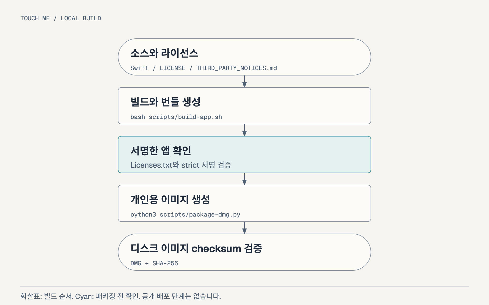

[English](Workflow.md) · [한국어](Workflow.ko.md) · [앱 사용 안내](README.ko.md) · [Homebrew 배포](docs/Homebrew.ko.md)

<!-- meta.contentType: How-to; audience: contributors; goal: build and package Touch Me locally; content plan: environment, modules, build, packaging, checks, recovery, release. -->

# Touch Me 로컬 빌드와 패키징

이 Workflow에 따라 arm64 앱을 빌드하고 번들을 확인한 뒤 개인용 디스크 이미지를 만드세요. 기존 스크립트는 Apple의 로컬 도구와 Python 3를 사용합니다. 추가 dependency 설치와 산출물 공개는 수행하지 않습니다.

## Beta.11 공개 — 2026-10-25

핀치·세 손가락 제스처를 포함한 beta.11/build 33과 Homebrew Cask를 공개했습니다.
앱 빌드와 DMG 패키징을 각각 한 번 실행했고 서명·DMG·공개 다운로드 검사를 통과했습니다.
실행 코드와 테스트는 제스처 commit `f386a89`와 같습니다. 입력 45개는 release
commit `0de6e5a`에 고정했으며 공개 Tap commit은 `49be006`입니다.
설치된 build 28과 Tap, 기존 산출물·환경설정·복구 기록을 보존했습니다.
새 빌드의 설치·upgrade·GUI·실기 검증은 **NOT_RUN**입니다.
[Release notes](docs/releases/v0.8.0-beta.11.md)에 식별과 검증 한계를 기록했습니다.

## 제스처 개발 후보 — 2026-10-25

현재 소스에 연속 핀치와 세 손가락 Mission Control·Space 전환을 추가했습니다.
이 개발 checkpoint에서는 `VERSION`과 Cask가 beta.10이었습니다. 이후 beta.11
공개 결과는 위에 기록했습니다.

- Core는 스크롤·핀치·세 손가락 동작을 판별한 뒤 동작 종류를 고정합니다.
  두 손가락 기준은 중심 이동 6단위, 간격 변화 `max(6, 초기 간격의 5%)`,
  우세 비율 1.5배입니다. 핀치는 초기 간격이 20단위 이상이어야 합니다.
  세 손가락 전환은 이동 40단위, 축 우세 비율 1.5배, 모든 손가락의 같은 방향
  이동을 요구합니다. 드래그 시작 기준은 기존의 8단위 초과를 유지합니다.
- HID 슬롯별 세대 번호로 관찰된 접촉 종료·재시작을 구분합니다. 같은 timestamp의
  재접촉도 구분하지만, 장치가 보고하지 않은 물리적 손가락 교체는 식별할 수 없습니다.
- `GestureEventAdapter`에 비공개 핀치 형식을 한정합니다. macOS 26에서 입력을
  보내지 않는 AppKit 변환 검사를 하고, 시작 전에 종료 이벤트를 준비합니다.
  Stop·입력 거부·lifecycle 중단은 한 번만 취소합니다. 다른 macOS major 버전이나
  형식 검사 실패 시 핀치만 비활성화하며 키보드 확대 단축키로 대체하지 않습니다.
- 시스템 전환은 기본 Control 방향키 단축키를 사용합니다. 물리적 modifier 키나
  마우스 버튼이 눌려 있으면 새 전환을 생략합니다. 방향키의 기본 `numericPad`·
  `secondaryFn` 플래그를 유지한 채 Control을 추가합니다. 실제 Mission Control
  검증에서 이 플래그가 필요함을 확인했습니다. Control 누름·해제도 짝지어 보내
  합성 modifier 상태가 다음 동작을 막지 않도록 합니다. 모든 해제 이벤트는
  전송 전에 준비합니다. macOS 설정은 변경하지 않습니다.
- 핀치 설정은 `io.github.soom-kang.touchme.pinchEnabled`에 별도로 저장합니다.
  기존 매핑·복구 기록 형식은 유지하며, 게시 횟수는 앱에서 처리된 횟수를 뜻하지 않습니다.

`bash scripts/test.sh`와 `git diff --check`로 검증합니다. 기존 Core·HID 테스트와
Platform 어댑터 테스트 파일 하나를 사용하며, 테스트는 전역 입력을 보내지 않습니다.
native 이벤트 소스를 만들려면 일반 macOS 실행 환경이 필요합니다. sandbox의
시스템 서비스 접근 차단을 제품 오류로 판단하지 마세요. 후보, 앱별 결과와 남은
P16KT 검증은 [QA 기록](docs/qa/automated-tests.md#gesture-expansion--2026-10-25)에 구분합니다.

기본 로컬 빌드는 ad hoc 서명으로, 별도의 개인정보 보호 권한이 필요할 수 있습니다.
설치된 인증서 서명 앱과 기존 권한 항목을 보존하세요. 이번 검증에서는 ad hoc build 29가
기존 권한을 사용하지 못해, 사용자 승인 후 기존 인증서로 로컬 build 30을 서명했습니다.
이후 build 31에서 방향키 기본 플래그 누락을 수정했습니다. build 32에서는 Control
누름·해제를 짝지어 연속 동작 사이에 합성 modifier 상태를 해제하도록 고쳤습니다.
두 수정 후 테스트 49개가 통과했습니다. 두 권한은 허용됨을 유지하며 설치된 build 28과
권한 항목은 보존했습니다. build 32의 세 손가락 연속 동작과 양쪽 Space 경계·복귀는
사용자가 정상으로 확인했습니다. Safari, Preview의 PDF·이미지, Chrome 핀치도
정상으로 확인했습니다. 핀치 중 Stop·재시작, 잠금·해제와 USB 재연결 후 복구도
새 입력까지 정상으로 확인했습니다. 현재 모니터 4대 배치에서 P16KT 입력 대상과
최종 중지도 정상이며, GUI에서도 복구 오류 없이 중지됨을 확인했습니다. 이 결과는
macOS 26.7.1을 사용하는 현재 Mac에 한정합니다.
build 30·31의 실패와 단독 진단 결과는 QA 기록에 보존합니다. 새 dependency·driver·daemon,
설치, 신뢰 설정 변경, 공개 배포는 이번 변경에 포함하지 않습니다.

## Beta.10 공개와 upgrade — 2026-10-14

상태는 **PUBLISHED; IN_PLACE_UPGRADE_PASS;
RETENTION_PASS_USER_REPORTED_ON_THIS_MAC**입니다. Beta.10/build 28을 01:14:28 KST
(2026-10-13 16:14:28 UTC)에 공개했습니다. Release source/tag
`8aaebe4530ece3e0b6309c3be0df3c2d57e4d07f`/`v0.8.0-beta.10`과 annotated tag
`51db567d54bd80987d5375a91e55cd80ba7f0f50`은
[동결한 입력 43개](docs/releases/v0.8.0-beta.10-inputs.json)와 같습니다.
익명 public DMG·sidecar bytes는 native 후보와 일치합니다. Cask 공개 Tap revision은
`27fd12ee7e39ec383919fd5333120afc55768ea4`입니다. 이후 문서만 수정한 commit은
이 release 식별과 구분합니다. [Release notes](docs/releases/v0.8.0-beta.10.md)에
정확한 산출물 hash와 결과를 기록합니다.

정상 Homebrew beta.9 → beta.10 upgrade 한 번을 01:19:31 KST
(2026-10-13 16:19:31 UTC)에 exit 0으로 마쳤습니다. 설치 파일 5개, strict
인증서·DR, receipt와 바깥 디렉터리 보존을 확인했습니다. Device `16777232`,
inode `109845586`은 같습니다. 직전 App Management 조건은 실제 native
`brew` host에서 통과했고 선택 Cask/전체 Tap trust는 `true`/`false`를 유지했습니다.
새 B10 PID `60924`의 `/Applications/Touch Me.app/Contents/MacOS/TouchMe`
경로, version/build와 실행 파일 hash는 공개 후보와 같습니다. 실행 후 읽기 전용
검사에서 환경설정·저장 매핑·guard·복구 manifest hash를 보존했습니다.
`resumeMapping=false`, active 0개, 유효 guard 1개와 archive 5개입니다.
사용자가 beta.10/build 28 GUI에서 재승인 없이 손쉬운 사용·입력 모니터링
모두 Allowed임을 확인했습니다. 결과는 **PASS_USER_REPORTED_ON_THIS_MAC**입니다.
01:27:59 KST에 같은 PID·경로·hash를, 01:28:03 KST에 상태 보존을 native로
재확인했습니다(2026-10-13 16:27:59/16:28:03 UTC). A9 → B10에서 Start나 권한
변경은 실행하지 않았습니다. 이 Mac의 같은 사용자·설치 경로에 한정한 결과이며
GUI 값은 사용자 보고입니다. 자동 조회 한 번은 native pipe가 닫혀 실패했습니다.
Native 검사는 process 식별과 상태 보존을 확인한 것이며 GUI 권한 직접 조회는
아닙니다.

Upgrade 후 첫 assertion은 prerelease를 숫자 `CFBundleShortVersionString`
(`0.8.0`)과 비교해 중단됐습니다. 전체 버전의 `TouchMeReleaseVersion`으로
바로잡고 검증만 이어갔으며 upgrade를 다시 실행하지 않았습니다. 최초 실패는
기록에 남겼습니다. 빌드·패키징 각 한 번은 exit 0이며 앱·내부 앱 strict 서명,
정확한 인증서·DR, 서로 다른 cdhash와 양방향 A9↔B10 DR, DMG 무결성·sidecar,
metadata, 읽기 전용 파일 5개, 양국어 안내와 정상 detach 검사를 통과했습니다.
바깥 DMG는 code signing하지 않았습니다. 비치명적인 CLT search-path 경고를
유지하고 toolchain은 바꾸지 않았습니다. 동등한 Cask 규칙은 설치된 호환
`spoom 1.8.9`로 통과했으며 정확한 locked toolchain의 PASS는 아닙니다.
Online audit는 합의한 trust 보존 범위에 따라 **BLOCKED**입니다. Fresh
Gatekeeper, 서명 identity 설치·추가 trust가 없는 수신 Mac과 실기기 acceptance는
**NOT_RUN**입니다. 기존 source tests와 과거 공개 checkpoint의 범위는 유지합니다.
로컬 근거는 `.build/releases/beta10-e3d38685ae/`에 있으며 운영자 개인 경로와
secret은 공개 문서에서 제외합니다.

## 공개 서명 검증 — 2026-10-13

A9 checkpoint의 상태는 **PUBLISHED; IN_PLACE_UPGRADE_PASS;
A9_BASELINE_PASS_USER_REPORTED**입니다. Beta.9/build 27을 2026-10-14
00:17:31 KST(2026-10-13 15:17:31 UTC)에 공개했습니다. Source/tag
`0414617c860451e0c7b2200294b0eeca651f9ad9`/`v0.8.0-beta.9`은
[동결한 입력 43개](docs/releases/v0.8.0-beta.9-inputs.json)와 일치합니다.
익명 public DMG·sidecar bytes도 native 후보와 같습니다. 공개·clean 로컬 Tap은
`65d13988d6f4bb415df8f5d6853a8c38c8d3b7fc`이며 전체 식별은
[release notes](docs/releases/v0.8.0-beta.9.md)에 기록합니다.

정상 Homebrew beta.8 → beta.9 upgrade 한 번을 2026-10-14 00:30:45 KST
(2026-10-13 15:30:45 UTC)에 exit 0으로 마쳤습니다. 설치 파일 5개는 공개
후보와 같고 strict 서명·장기 인증서·DR 검사를 통과했습니다. 앱 바깥 디렉터리의
device `16777232`와 inode `109845586`도 유지됐습니다. Upgrade 직전 같은
native `brew` host의 정확한 App Management 조건을 확인했습니다. 선택 Cask
trust `true`와 전체 Tap trust `false`는 그대로입니다.

최초 A9 PID `26957`에서 권한 하나 이상이 필요하다는 사용자 보고가 있었으며
개별 before 값은 미확인입니다. 최초 승인과 재실행 뒤 PID `35272`의 정확한
공개 실행 파일 경로·hash를 확인했습니다. 사용자가 GUI beta.9/build 27의
손쉬운 사용·입력 모니터링 모두 Allowed임을 확인했습니다. Baseline은
**PUBLIC_SIGNED_A9_GUI_PERMISSION_BASELINE_PASS_USER_REPORTED**입니다.
정상 Quit은 사용자 보고이며 native PID 부재도 확인했습니다. Start는 실행하지
않았습니다. 자동 GUI 조회 channel은 reset·재시도 뒤에도 사용할 수 없었습니다.

읽기 전용 실행 후 검사는 통과했습니다. 환경설정·저장 매핑·guard·전체 복구
manifest hash는 같으며 `resumeMapping=false`, active record 0개, 유효한
guard 1개와 archive 5개를 보존했습니다. Guard는
`DIFFERENT_BOOT_VALID_HISTORICAL_GUARD`로 분류합니다. 이전 boot의
일치하는 archive가 있는 유효한 기록이며 active record는 없습니다. 최초 제한
executor의 process·boot 조회는 실패했지만 이후 native 조회에서 기존 process가
없음을 확인했습니다. Boot 일치 assertion은 쓰기 전에 중단됐으며 source를
검토한 뒤 upgrade 사전 조건에서 제외했습니다. Active record가 없는 경로는
현재 boot와 같아야 한다는 조건 없이 기존 guard를 검증합니다. 기록은 보존했고
파일 검사로 물리 장치 모드나 durable cleanup을 입증하지는 않습니다.

Native checkpoint — 2026-10-13 23:46:41 KST: 빌드·패키징 각 한 번을 exit 0으로
마쳤습니다. 앱·내부 앱 strict 서명, 정확한 인증서·DR, metadata, arm64,
라이선스·아이콘, DMG 무결성·checksum, 읽기 전용 파일 5개 비교, 양국어 안내,
Applications 바로가기와 정상 detach를 확인했습니다. 당시 후보는 실행하지
않았으며 기존 설치 앱·로컬 archive·이전 이미지를 보존했습니다. 바깥 DMG는
code signing하지 않았습니다. 동등한 Homebrew Cask style 규칙은 파일 1개,
offenses 없음으로 통과했습니다. Lock의 `spoom 1.8.10`이 없어 첫 실행은
exit 2로 중단됐고 설치된 호환 버전 `1.8.9`의 load path를 해당 process에만
추가했습니다. Gem 설치, 설정·trust 변경과 추가 Cask 규칙 제외는 없었습니다.
정확한 locked toolchain의 PASS는 아니며 online audit는 기존 합의에 따라
**BLOCKED**입니다.

이 A9 checkpoint에서 beta.9 → beta.10 권한 유지는 **NOT_RUN**이었습니다.
이후 공개·upgrade와 새 GUI 확인 결과는
[beta.10 기록](#beta10-공개와-upgrade--2026-10-14)에 기록합니다. Fresh
Gatekeeper, 실기기 acceptance와 서명 identity 설치·추가 trust가 없는 수신 Mac도
**NOT_RUN**입니다. Receipt, 환경설정, 복구, trust·developer 설정과 이전 공개
산출물을 보존합니다. 아래 구간은 당시 checkpoint를 유지합니다. 로컬 근거는
`.build/releases/beta9-e62595b427/`의 `public-download-verification.json`,
`tap-publication.json`, `upgrade-state.json`, `postlaunch-preservation.json`에
있으며 운영자 secret은 제외합니다.

## Beta.8 release — 2026-10-12

상태는 **PUBLISHED**입니다. Prerelease `v0.8.0-beta.8`, build 26을
10:41:21 KST(01:41:21 UTC)에 공개했습니다. Release source/tag `e97d1720`은
동결한 입력 43개와 일치합니다. 공개 DMG와 checksum은 검사한 후보와 바이트
단위로 같습니다. 공개·검토·설치된 Tap revision `47a3e433`은 실제 Cask와
일치하며 로컬 Tap은 clean fast-forward로 갱신했습니다. 전체 식별과 결과는
[beta.8 release notes](docs/releases/v0.8.0-beta.8.md)에 기록합니다.

별도 checkout에서 앱과 DMG를 각각 한 번 생성했습니다. Bundle metadata,
strict ad hoc 서명, arm64, 라이선스·아이콘, native DMG 무결성·sidecar,
내부 앱 파일 5개의 hash, 설치 안내, Applications symlink와 정상 detach를
확인했습니다. Source가 같은 기존 Swift 38개와 packaging 22개 PASS는
재실행 없이 재사용했습니다. 빌드·패키징에 사용하는 입력은 `VERSION`만
바뀌었고, 최종 43개 manifest에는 패키징 후 확정한 Cask draft도 포함됩니다.

실제 Cask Ruby 문법과 동등한 Homebrew style 규칙은 설치된 vendored RuboCop
wrapper로 통과했습니다(파일 1개, offenses 없음). 첫 style 실행은 source
디렉터리에서 시작해 exit 130으로 중단했으며 Tap 디렉터리에서 바로잡은
실행은 통과했습니다. `brew style` front-end와 gem 설치·정리는 실행하지
않았습니다. 이전 release 7개, asset 14개와 tag ref 14개의 식별도 보존됐습니다.

Online audit는 합의한 trust 보존 범위에 따라 **BLOCKED**입니다. Trust와
Developer 변경 명령은 실행하지 않았습니다. Build 26 GUI·실기기 동작,
설치·upgrade·Gatekeeper와 로그인·잠금·절전·crash acceptance는 **NOT_RUN**입니다.
설치 앱, 복구 기록, 환경설정과 기존 로컬 산출물도 유지합니다. 아래 과거
기록은 당시 산출물과 승인 범위를 보존합니다.

설치 앱·복구 기록·환경설정·기존 산출물과 대상 trust/developer 상태는 baseline에
일치합니다. 공유 trust-store raw hash는 달라졌으며 원인·변경 주체는 미확인입니다.
복구 조작은 하지 않았습니다. [보존 한계](docs/releases/v0.8.0-beta.8.md#상태-보존과-관측-한계)를 확인하세요.

## 손쉬운 사용 서명 시험 — 2026-10-12

상태는 **PROBE_RETENTION_PASS; 서명한 Touch Me release는 미공개**입니다.
공개 beta.8/build 26의 ad hoc 서명, public asset과 Cask는 그대로 유지합니다.
앱은 `AXIsProcessTrusted()`로 권한을 확인하며 승인을 초기화하거나 부여하지
않습니다. Ad hoc 서명은 재빌드할 때 바뀌는 code hash로 앱을 구분합니다.
같은 서명 identity를 유지하면 업데이트의 designated requirement(DR)도 유지할
수 있습니다. [TCC identity에 관한 Apple DTS 설명](https://developer.apple.com/forums/thread/678816)

점검한 beta.7/build 25 후보와 설치된 beta.8/build 26은 Bundle ID가 같고
각각 strict 검사를 통과했지만 양쪽 cross-DR 검사는 실패했습니다.
Ad hoc identity가 바뀐 것은 직접 확인했으며 특정 Homebrew upgrade에서
권한 metadata도 삭제됐는지는 아직 확인하지 않았습니다.

승인된 시험은 별도 identifier를 가진 임시 AppKit 앱으로 진행했습니다.
Touch Me, HID, 환경설정이나 복구 코드는 사용하지 않았습니다. A와 B는 실행
파일 bytes가 다르지만 같은 self-signed 시험 인증서와 인증서에 고정한 DR을
사용했습니다. Strict 서명 검사와 A↔B requirement 검사를 통과했고 같은
identifier의 ad hoc control은 A의 requirement를 만족하지 못했습니다.
이 control은 서명 검사 결과이며 native TCC 거부를 검증한 것은 아닙니다.

확인한 DR은 identifier
`io.github.soom-kang.touchme.permission-probe.a3d14357a8564d82a728df0d19f008fc`와
`certificate leaf = H"<certificate SHA-1>"`을 사용하며 fingerprint는 아래와 같습니다:

| 동결한 서명 근거 | 값 |
| --- | --- |
| Certificate SHA-1 / DR leaf pin | `fd7559b266965ecd48f540e3a7038570e3f1a38d` |
| A executable SHA-256 | `cbd031967862542ef9206439d49af765eefce134a886c30de88b08ab6f0a7d7a` |
| B executable SHA-256 | `38559bccce57061d6bcd0afba9196f5558c46b692a4d254736aabca4747a0ca6` |

| Native 관측 | 결과 |
| --- | --- |
| 최초 A, PID 503 | 손쉬운 사용 false |
| 수동 승인 후 새 A, PID 6588 | 14:27:02 KST(05:27:02 UTC)에 true |
| A→B 교체 후 새 B, PID 8347 | 교체 중 권한 설정을 바꾸지 않고 14:27:51 KST(05:27:51 UTC)에 true |
| 교체 식별 | 같은 live bundle 경로와 바깥 디렉터리 inode 유지; 실행 파일 hash는 다름 |
| 인증서 trust | User, admin, system trust 설정을 추가하지 않음 |

최초 승인에는 재시도가 필요했습니다. TCC allowed 기록은 보였지만 임시 앱의
LaunchServices URL lookup이 실패했고 시스템 설정에 Probe 항목이 보이지
않았습니다. 이후 새 A process가 true를 반환했습니다. 권한 유지 시험 전에는
명시적인 LaunchServices registry 보정을 하지 않아 최초 문제의 원인은 미확인입니다. 로컬 근거는
`/private/tmp/touch-me-permission-probe-q7qkss10/`의 `probe-result.json`,
`signature-evidence.json`, `replacement-evidence.json`에 보존했습니다.

A→B 수용 시험 후 live Probe 경로에 public `LSRegisterURL(url, false)`를
실행해 status 0을 받았지만 Bundle ID의 URL 조회 결과는 비어 있었습니다.
이후 사용자가 승인한 동일 서명의 B 복사본을 `.build/permission-probe-cleanup/`에
준비했습니다. 이 경로의 등록은 status 0과 예상한 URL을 반환했고 시스템
설정을 다시 열자 허용된 Probe 항목이 표시됐습니다. 정리용 복사본은 실행하지
않았습니다. 사용자가 Probe 항목을 수동 제거한 뒤 새 손쉬운 사용 UI에서
항목이 없고 실제 Touch Me 항목은 ON인 것을 확인했습니다. 정확한 Bundle ID와
B 실행 파일 hash를 확인한 뒤 정리용 복사본과 빈 부모 디렉터리를 제거했으며
Probe process도 남지 않았습니다. 14:48:37 KST(05:48:37 UTC)의 정리 관측은
**PASS_USER_REMOVAL_UI_CONFIRMED**입니다. 등록과 정리는 권한 유지 검증 후에
수행했으므로 앞선 PASS의 일부가 아닙니다. 이후 사용자가 시험 Keychain만
삭제하도록 승인했습니다. 정확한 경로와 공개 인증서 fingerprint를 대조하고
기본 Keychain이 아님을 확인한 뒤 해당 경로의 `security delete-keychain`을
실행했습니다. 삭제가 성공했으며 파일이 없는 것을 확인했습니다. 원래 임시
앱, 공개 인증서와 근거는 보존했고 key 정리는 **DELETED_WITH_USER_APPROVAL**입니다. 로컬
`registration-cleanup-evidence.json`과 갱신한 `probe-result.json`에 기록했습니다.

이 PASS는 현재 Mac, 사용자와 경로에 한정됩니다. 수용 시험 당시에는 전용
시험 Keychain과 private key가 있었으며 시험 후 삭제했습니다. 인증서와
private key를 Keychain에 별도로 설치하지 않고 인증서 trust도 추가하지 않은
수신 Mac의 시험과 실제 Touch Me/Homebrew
upgrade는 **NOT_RUN**입니다. 시험 identity는 release에
사용하지 않습니다. Probe 권한 항목 정리는 완료했습니다.
장기 maintainer identity 준비는 아래에서 검증했습니다. Native 서명 Touch Me
빌드와 패키징, 실제 upgrade는 각각 승인된 실행 범위가 필요합니다. 공개 ad hoc identity에서
전환할 때는 수동 재승인이 한 번 필요할 수 있으며 이후 권한 유지도 native
acceptance로 확인해야 합니다. Self-signed 서명은 Developer ID, 공증이나
Gatekeeper 승인의 근거가 되지 않습니다.

Apple은 self-signed 앱의 배포를 권하지 않습니다. 같은 인증서로 버전 간
출처가 같다는 것은 확인할 수 있지만 수신자가 maintainer의 신원을 확인할
수는 없습니다. 사용자는 이 한계를 전제로 개인 Homebrew beta Tap의 무료
self-signed 시험을 선택했습니다. 서명한 release는 공개하지 않았습니다.
[Apple Code Signing Tasks](https://developer.apple.com/library/archive/documentation/Security/Conceptual/CodeSigningGuide/Procedures/Procedures.html)

Pilot checkpoint의 source 검사는 `python3 -m unittest discover -s Tests/PackagingTests -v`
(기존 22개와 좁은 서명 사례 4개, 총 26개)와 `bash -n scripts/build-app.sh`를
통과했습니다. 서명한 Probe와 ad hoc control의 native `codesign` 통합 조회도
통과했습니다. 제한된 executor에서는 인증서 추출 결과를 읽을 수 없었으며
native Mac 조회는 trust 추가나 ad hoc 전환 없이 통과했습니다. Mock packaging
검사와 Probe 조회로 native 서명 Touch Me 앱이나 DMG를 검증했다고 볼 수는
없습니다. 이후 [로컬 후보 검사](#로컬-인증서-서명-touch-me-후보--2026-10-12)는 별도로
기록합니다. Core, Platform과 App 코드는 유지해 Swift tests를 반복하지 않았습니다.

## Release signing identity 준비 — 2026-10-12

상태는 **GENERATED; RESTORE_SIGNING_PASS**입니다. 장기 self-signed identity는
삭제한 시험 identity와 구분합니다. 공개 인증서 metadata는 다음과 같습니다:

| 항목 | 값 |
| --- | --- |
| CN | `Touch Me Release Signing` |
| Key / signature | `RSA 4096` / `sha256WithRSAEncryption` |
| 유효 기간 | `3650 days`; `2026-10-12T08:01:07Z` → `2036-10-09T08:01:07Z` |
| Certificate SHA-1 | `e7491a0b49d0784093d48b2bb30b298df3a924f9` |
| Certificate SHA-256 | `f58a3ca4f6dcfda8f04192c5170288b3a5ffb286acbcae147ead120892002819` |

사용자는 native 대화상자에서 password로 보호한 PKCS#12 export와 import를
완료했습니다(`USER_REPORTED`). 백업 파일 존재, `0600`과 부모 디렉터리의
`0700`은 직접 확인했습니다. Agent는 백업 내용을 읽거나 복사하지
않았습니다. FileVault는 켜져 있습니다. 독립 저장 장치는 **NOT_AVAILABLE**이며
같은 Mac의 암호화 파일만으로는 장치 손실에 대비할 수 없습니다.

전용 Keychain의 **My Certificates**에서 private key가 연결된 identity를
선택하고 **File → Export Items**로 암호화한 `.p12`를 저장하세요. 인증서만
담은 `.cer`는 identity 백업이 아닙니다. 같은 CN으로 새로 만드는 것은 다른
identity이므로 기존 identity를 복구해야 합니다. macOS 26.4 이후에는
Keychain을 열 때 protected entropy가 필요할 수 있어 Keychain 파일 복사만으로
백업을 검증했다고 볼 수 없습니다. [Apple TN3137](https://developer.apple.com/documentation/technotes/tn3137-on-mac-keychains)

별도 임시 복구 Keychain의 private key로 서로 다른 내용의 dummy 앱을 서명했습니다.
원본과 복구 dummy 모두 strict 서명, 내장 인증서 SHA-1/SHA-256 일치와 양쪽
DR 검사를 통과했습니다. Identifier
`io.github.soom-kang.touchme.release-identity-check.e404eb4a952a4a0abe693c35eff316ff`와
위 인증서의 leaf hash pin은 같고 cdhash는 다릅니다:

| Dummy | cdhash |
| --- | --- |
| Source | `84142f0e4e0ad9f7248a6a33e45e1d3433a93a47` |
| Restored | `c16afb96b34262ea9bcbc3095ad5dc145ec82303` |

두 앱은 실행하지 않았습니다. User, admin, system domain에 인증서 trust
항목도 추가하지 않았습니다. 이 Mac의 복구 검증은 17:28:37 KST(08:28:37 UTC)에
완료했으며 다른 Mac에서의 복구는 **NOT_RUN**입니다. Git 밖의 장기 Keychain은
`0600`, 300초 후 잠금, sleep 시 잠금과 기본 Keychain이 아님을 직접 확인했습니다.
Password와 private 경로는 이 문서에 기록하지 않습니다. 임시 복구 Keychain은
**DELETED_WITH_USER_APPROVAL**로 정리했습니다. 정확한 경로, 유일한 인증서의
SHA-1/SHA-256과 기본 Keychain이 아님을 확인한 뒤 해당 대상만 삭제했습니다.
파일과 search-list 항목이 없는 것을 확인했습니다. 당시 원본 release Keychain은
잠근 채 보존했고 암호화 백업도 유지했습니다. 정리는
17:34:45 KST(08:34:45 UTC)에 완료했고 로컬 `restore-cleanup-result.json`에 기록했습니다.

17:34:45 KST의 identity 준비 checkpoint에서는 native 서명 Touch Me 빌드,
DMG 패키징, 설치, Homebrew upgrade, 서명 identity를
별도로 설치하거나 trust를 추가하지 않은 수신 Mac의 시험, Gatekeeper와
서명 release 공개는 **NOT_RUN**이었습니다. 이후 [로컬 후보 검사](#로컬-인증서-서명-touch-me-후보--2026-10-12)는
빌드와 패키징 산출물만 확인했습니다. 설치 수용 시험과 push·공개는 별도 승인
범위를 유지하며 공개 beta.8은 기존 ad hoc release입니다. 근거 JSON은 Git 밖
로컬의 다음 파일에 보존합니다:
`certificate-public-metadata.json`, `source-signing-result.json`,
`backup-export-result.json`, `restore-verification-result.json`.
`backup-export-result.json`은 export 시점의 `restore=NOT_RUN` snapshot을
그대로 보존합니다. 최종 복구 결과는 이후 생성한 `restore-verification-result.json`에 있습니다.

## 로컬 인증서 서명 Touch Me 후보 — 2026-10-12

상태는 **NATIVE_ARTIFACT_PASS; 로컬 후보 전용**입니다. macOS 26.7.1(`25G241`),
Apple Silicon과 Apple Swift 6.4에서 빌드와 패키징을 각각 한 번 실행해 exit 0으로
마쳤습니다. Source HEAD `0e73df845d3b796fdcb7693ce7d4999dd38d5093`와 승인된
11개 파일의 working diff로 후보를 만들었습니다. 빌드와 패키징 중 입력은
유지됐으며 이후 결과를 기록한 문서 수정은 binary를 바꾸지 않습니다.
이전 로컬 beta.7/build 25를 기준으로 build 26을 생성했습니다.

이 후보는 공개 ad hoc release와 `0.8.0-beta.8`/26이 같지만 준비한 장기
인증서로 서명했고 실행 파일과 DMG bytes는 다릅니다. Version/build만으로
구분하지 말고 공개 asset과 Cask는 그대로 유지하세요.

| 후보 식별 | 값 |
| --- | --- |
| Release / build / target | `0.8.0-beta.8` / `26`; `io.github.soom-kang.touchme`, `arm64` |
| Embedded certificate SHA-1 | `e7491a0b49d0784093d48b2bb30b298df3a924f9` |
| Embedded certificate SHA-256 | `f58a3ca4f6dcfda8f04192c5170288b3a5ffb286acbcae147ead120892002819` |
| Executable SHA-256 | `2b6b432ec94a06609fe9deba1521ac4e9736a54159933193bca44e76b2051069` |
| DMG size / SHA-256 | `525417 bytes`; `f481cb21f7c34a5d5e99a0620bf7b25c2c4ca8056058b54f3384108d299fb919` |

Native strict 앱 검사, 내장 인증서 일치, identifier와 certificate-leaf로
구성된 DR, arm64, version/build metadata와 라이선스·아이콘 검사를
통과했습니다. 앱 cdhash는 `b35b3a8024952ba60f78fead2d3399b91ba49308`입니다.
DMG는 native `hdiutil verify`, sidecar `shasum`과 읽기 전용으로 마운트한
내부 앱의 bytes 일치, strict 서명, 인증서와 DR 검사를 통과했습니다.
두 언어의 `Install.txt`, Applications 바로가기와 정상 detach도 확인했습니다.
Packager는 바깥 DMG 자체에 code signing을 하지 않았습니다. 이 결과는 내부
앱 서명과 이미지의 무결성·checksum을 확인한 것입니다.

이전 로컬 앱은 같은 bytes로 archive에 보존했습니다. 기존 beta.7 이미지와
설치 앱도 유지됐습니다. User, admin, system domain에 인증서 trust를
추가하지 않았고 후보 앱은 실행하지 않았습니다. 산출물 검증은
17:59:56 KST(08:59:56 UTC)에 완료했습니다. 이후 장기 Keychain을 잠갔고 `0600`,
300초 후 잠금과 sleep 시 잠금, 기본 Keychain이 아님과 암호화 백업의 `0600`
유지를 로컬 `keychain-final-state.json`에서 확인했습니다. 로컬 근거는 Git 밖의
`.build/signing-validation/2026-10-12-5eb15eb5df/`에 있는
`native-app-verification.json`, `native-artifact-verification.json`,
`environment.json`에 보존했으며 운영자의 private 경로는 이 문서에 넣지 않습니다.

손쉬운 사용과 입력 모니터링 권한 유지, 설치·Homebrew upgrade, 서명 identity를
별도로 설치하거나 trust를 추가하지 않은 수신 Mac의 시험, Gatekeeper,
서명 release 공개와 push는 **NOT_RUN**입니다. 산출물 PASS만으로 권한 유지
목표를 검증했다고 볼 수 없으며 해당 작업은 별도 승인 범위를 유지합니다.

## Beta.8 이전 source QA 기준 기록 — 2026-10-12

`65a8e71` 위의 수정한 checkout에서 `bash scripts/test.sh`(App 컴파일과 38개 tests)와
기존 packaging suite(22개)를 macOS 26.7.1/arm64에서 각각 한 번 실행해 통과했습니다.
TMQA-006은 journal lease 아래에서 빈 기록의 directory sync를 확인하며,
TMQA-007은 완전한 DMG/checksum 쌍을 staging에 준비하고 최종 반영 실패 시 복구합니다.
기존 test target에서 해당 실패 경계를 확인했습니다. 합의한 결정과 한계는
[QA 보고서와 로컬 티켓](docs/qa/2026-10-12-qa-report.md)에 기록합니다. 이후
[로컬 native build](docs/qa/2026-10-12-native-build.md)에서 앱과 DMG를 각각 1개 생성하고
서명/이미지, 읽기 전용 inner-app 비교와 정상 detach를 확인했습니다. 첫 native 이미지
생성은 실패했으며 같은 staging을 재사용해 재시도하고 마무리했습니다. 앱과 package
staging을 다시 빌드하지 않았습니다. `--scan`의 CLI 환경에는 장치/화면이 보이지
않았습니다. GUI, 설치, commit/push와 공개는 수행하지 않았으며 아래 기록은 과거 근거로 유지합니다.

## 개발 환경 준비하기

Apple Silicon Mac, macOS 26 이상, 패키지의 Swift 6.0 manifest와 호환되는 Swift 도구, Python 3가 필요합니다. 프로젝트 폴더에서 명령을 실행하세요. 빌드에는 터치 모니터 연결이 필요하지 않습니다.

앱의 식별자와 버전은 다음 값을 유지합니다:

| 항목                  | 값                                   |
| --------------------- | ------------------------------------ |
| 앱과 실행 파일        | `Touch Me.app` / `TouchMe`           |
| Bundle Identifier     | `io.github.soom-kang.touchme`        |
| Release 버전          | `VERSION`에서 읽는 `0.8.0-beta.11`    |
| 번들 버전             | `0.8.0`과 증가하는 숫자 build 번호   |
| 전체 release metadata | `TouchMeReleaseVersion=0.8.0-beta.11` |
| 대상 환경             | `arm64`, macOS 26 이상               |

문서나 패키징을 바꿀 때는 식별자와 저장한 환경설정 형식을 유지하세요. 서명 identity나 설치 경로를 바꾸면 설치 앱의 권한 확인이 필요할 수 있습니다.

## 모듈별 역할 확인하기

패키지는 실행 상태 로직, macOS 장치 접근과 앱 제어를 나눕니다:

| 모듈               | 역할                                                                            |
| ------------------ | ------------------------------------------------------------------------------- |
| `TouchMappingCore` | 좌표 정규화, 화면 좌표 변환과 접촉 상태별 효과 계산                             |
| `TouchMePlatform`  | USB Human Interface Device(HID) 탐색, 화면 선택, P16KT 모드 복구와 macOS 이벤트 |
| `TouchMeApp`       | 메뉴 막대, 설정·시험 창, 환경설정, 로그인 실행과 재개 판단                      |

앱은 확인한 패널 한 대와 조건에 맞는 외부 화면을 사용합니다. 매핑은 장치를 독점 점유하고 필요한 경우 확인한 모드를 켭니다. 중지하거나 정상 종료하면 확인한 연속 연결에서 원래 모드로 복구합니다. 연결 종료를 확인한 경우에는 [journal 계약](docs/qa/abnormal-exit-recovery.md)에 따라 복구를 확인하지 못한 archive를 보존합니다. 복구나 archive 오류는 화면에 남고 종료를 차단할 수 있습니다.

현재 소스에는 앱의 네트워크 통신이나 원시 입력 로그 기능이 없습니다. 환경설정에는 선택한 장치·화면 정보, 재개할 의도와 앱 언어 선택을 저장하며, 터치 이력은 저장하지 않습니다. 기본 언어는 영어입니다. 언어를 바꾸면 앱이 만든 UI를 즉시 갱신하며 세션을 재시작하거나 macOS 언어 설정을 바꾸지 않습니다.

## Beta.7 release 준비 — 2026-10-10

이 절은 완료한 beta.7 공개 기록입니다. 공개 build 25와 이후 로컬 QA build 25는
서로 다른 산출물이며 어느 쪽도 beta.8 acceptance를 검증하지 않습니다.

상태는 **PUBLISHED**입니다. Prerelease `v0.8.0-beta.7`을 2026-10-10
14:25:14 KST(05:25:14 UTC)에 숫자 번들 버전 `0.8.0`, build 25로 공개했습니다. 개발 build 24와 설치 앱은
보존하며 로컬 앱 설치나 upgrade는 포함하지 않습니다.

아래 Swift tests 37개와 USB-C cycle 한 번을 개발 실행 파일 SHA-256
`06306a6ed873d314ab565066b42d5a022618ea067a53cd76abceb7333f2e41f7`에 연결해
재사용합니다. 매핑 코드를 유지하며 build 25의 새 GUI·실기기 acceptance는 없습니다.

| Release 검사 | 현재 상태 |
| --- | --- |
| 재사용한 source tests / build 24 USB-C cycle | `PASS`(37개) / `PASS_USER_REPORTED`(1회) |
| 새 build 25, 패키징·tests와 실제 Cask syntax·style | `PASS`; 빌드·패키징 각 1회, tests 18개, Cask 파일 1개에서 offenses 없음 |
| Source·tag·prerelease와 익명 public DMG·sidecar | `PUBLISHED` / 정확한 bytes 확인 `PASS` |
| 공개·별도 clone·설치된 Tap revision | `PASS`; `7c07d49`와 검토한 Cask 일치, 설치된 Tap clean fast-forward 완료 |
| 이전 beta.1–beta.6 공개 기록 | `PASS`; release 6개·asset 12개·tag/peeled refs 12개의 metadata 보존 |
| `brew audit --cask --online soom-kang/touch-me/touch-me` | `BLOCKED`; 승인한 보류에 따라 trust 설정과 우회 변수를 변경하지 않음 |
| Build 25 GUI·실기기, 설치·upgrade·Gatekeeper | `NOT_RUN`; release 범위 밖 |

`scripts/package-dmg.py`의 양언어 `Install.txt` 안내를 포함한 release 입력을
확정한 뒤 빌드·패키징을 각각 한 번 수행합니다. 입력을 release commit과 비교해
동결하고 새 번들·DMG를 검증합니다. Public 다운로드 bytes와 sidecar를 확인한
뒤 기존 Tap을 갱신합니다. Audit 보류와 별개로 Cask syntax·style과 public asset
식별은 필수입니다. 실제 revision·hash·결과는
[beta.7 release notes](docs/releases/v0.8.0-beta.7.md)에 기록합니다.
Beta.6 당시 online audit PASS는 과거 근거로만 보존합니다.

로컬 build 25의 컴파일·strict 서명·metadata·라이선스·아이콘·arm64 검사는
통과했습니다. 패키징은 한 번 통과했고 기존 packaging tests 18개도 통과했습니다.
Frozen inputs 28개가 일치했습니다. DMG 무결성·sidecar, 읽기 전용 mount 내부
identity(정확한 파일 5개), 양언어 설치 안내, Applications symlink와 정상 detach도
통과했습니다.

| 동결한 public 산출물 | 확인한 식별 |
| --- | --- |
| Build 25 실행 파일 SHA-256 | `b0ea3a8daecbb45cb75fb680941401e4ab679e9da7a8fe44c742975d38e309d4` |
| DMG 크기 / SHA-256 | 524,843 bytes / `74bf81ff7e7d1a0a1966146022b7e60841451897fee25a2dbe1449b31113da90` |

기존 Command Line Tools linker search-path 경고는 검사를 막지 않았습니다.
첫 상대 경로의 `hdiutil verify`는 경로 오류로 실패했고 정확한 절대 경로로
재시도해 통과했습니다. 산출물 변경이나 추가 패키징은 없었습니다.
2026-10-10 익명 public DMG·sidecar 확인은 통과했습니다. Raw bytes·크기·digest와
checksum 내용이 동결한 release와 일치합니다. Release 입력 28개는 source·tag
commit `f8210f4318f726c9943db1de7fa82e634d132a10`과 일치합니다.
Annotated tag object는 `0ea81d53133a218f661160db533e43d84a6e3177`입니다.
2026-10-10 14:28:27 KST(05:28:27 UTC) checkpoint에서 공개 Tap·별도 clone·설치된
Tap의 revision은 모두 `7c07d4967e94e0591229410f8952bb49c2b7e102`였습니다.
`/opt/homebrew/Library/Taps/soom-kang/homebrew-touch-me`는 `3c3ab9e`에서
`fetch`와 `merge --ff-only`로 fast-forward했고 clean 상태를 유지했습니다.
파일 4개가 공개 clone과 일치하며 Cask는 source template과 일치합니다.
Tap checkout만 갱신했으며 앱 설치·upgrade나 trust 변경은 없었습니다.

## USB-C 재연결 후보 — 2026-10-10

이 개발 검증 snapshot은 beta.7 release 준비 전 재연결 변경의 결과입니다. 당시 `VERSION`, 기존 active record schema와 `SavedMapping`을 유지했습니다. 공개 beta.6와 이전 acceptance 기록도 당시 확인 범위를 보존합니다. 완료한 개발 작업에는 commit·push·release·Tap 갱신·DMG 패키징을 포함하지 않았으며 beta.7 release 범위는 위에 구분했습니다.

모드를 변경한 active record가 있으면 독점 lease, 같은 부팅, 정확한 nonce와 현재 소유자 또는 종료가 확인된 이전 소유자를 확인합니다. 정확한 이전 HID와 USB 서비스가 모두 종료됐음을 확인해야 하며 조회 오류는 연결 해제로 보지 않습니다. `disconnected-<nonce>.json` → `reconnect-required.json` → active record 제거 순서로 저장하고 sync합니다. Archive는 복구를 확인하지 못한 기록이며 이전 모드 값을 새 연결에 쓰지 않습니다.

Active record 없이 당시 읽은 `(0,0)`이나 `(2,0)`이 유지된 경우에는 정확한 값, 식별과 소유자를 포함한 guard를 먼저 저장한 뒤 archive를 저장합니다. 재실행에서 유효한 guard에 대응하는 archive가 없으면 장치 쓰기 없이 파일 근거로 canonical archive를 보완합니다.

실패한 단계는 다른 기록을 덮어쓰지 않고 재시도합니다. 시작 중 guard 제거 sync에 실패하면 rollback 전에 guard를 다시 영구 저장합니다. 저장 문제가 남으면 오류를 표시하고 정리를 차단합니다.

자동 시작은 장치를 독점으로 연 뒤 저장한 USB 위치, descriptor, 지원 패널 한 대, 화면 UUID, 현재 좌표, 권한과 세션을 확인합니다. 새로 읽은 `(0,0)`만 자동 시작을 허용합니다. `(2,0)`은 안내 후 직접 시작해야 하며 중지 뒤에도 `(2,0)`을 유지합니다. 재연결 확인 기록은 재실행 후에도 유지하고 새 기본 모드 journal이 준비되거나 직접 시작을 승인한 뒤에만 해제합니다. 완료 전 케이블 대기 의도는 메모리에만 둡니다.

케이블이 없는 동안 기존 1초 timer를 사용합니다. 장치가 처음 다시 나타나면 고정된 10초 준비 확인 구간을 시작하며 중복 알림으로 연장하지 않습니다. 중지, 대상 선택이나 정상 종료는 대기를 취소합니다. 화면 변경 알림이 HID 제거보다 먼저 도착하면 기존 2초 분류와 1초 poll로 정확한 이전 서비스의 종료를 확인합니다. 일반 잠금·절전 복구 규칙은 유지합니다.

기존 targets와 `bash scripts/test.sh`로 집중 검증하고 `bash scripts/build-app.sh`로 후보를 한 번 빌드합니다. 이후 승인한 후보 cycle **시작 → 분리 → 재연결 → 자동 재개 → 두 위치 탭 → 중지**를 확인합니다. 기존 앱과 산출물을 보존합니다. 앱 전환에는 정상 종료를 사용하며 종료가 막히면 기록을 보존하고 구체적인 전환 절차를 합의합니다. 이전 프로세스가 없음을 확인한 뒤 후보를 실행합니다. 로컬 검사만으로 실기기 cycle 성공을 판정하지 않습니다.

| 후보 검사 | 현재 결과 |
| --- | --- |
| Swift 컴파일과 기존 tests | `PASS`: 37개(Platform 24개, Core 13개), 앱 컴파일 포함 |
| 후보 앱 빌드와 strict 서명 | `PASS`: `bash scripts/build-app.sh` 1회, 컴파일·번들 생성과 내장 strict 서명 검증, exit 0 |
| 기존 앱 종료와 로컬 후보 실행 | 정상 종료 `BLOCKED_USER_REPORTED`; 별도 승인한 1회 전환과 후보 실행 `PASS` |
| 승인한 USB-C cycle과 두 위치 탭 | 2026-10-10 `PASS_USER_REPORTED`: 시작 → 같은 USB-C 분리·재연결 → 자동 재개 → 두 위치 탭 → 중지 1회; 승인한 acceptance 범위 충족 |
| 새 release, Homebrew 설치나 upgrade | 수행하지 않음; 범위 밖 |

개발 checkpoint 당시 source checkout의 후보는 `dist/Touch Me.app`이며
release `0.8.0-beta.6`, 숫자 번들 버전 `0.8.0`, build 24였습니다(이전 로컬
build 23 → 24). 설치 앱도 beta.6/build 24로 표시돼 아래 경로와 hash로
구분했습니다. 별도 beta.7 release checkout에는 현재 build 25가 있으며
아래 표는 개발 checkpoint의 식별입니다:

| 실행 파일 | SHA-256 |
| --- | --- |
| `dist/Touch Me.app/Contents/MacOS/TouchMe` | `06306a6ed873d314ab565066b42d5a022618ea067a53cd76abceb7333f2e41f7` |
| `/Applications/Touch Me.app/Contents/MacOS/TouchMe` | `7a2bcd46e4ec2e0a507ebe4b0230c6ad993f9ce92a287c102d1048c483432945` |

사용자가 복구 오류 때문에 설치 앱의 정상 종료가 막혔다고 보고했습니다.
별도 1회 승인에 따라 정확한 경로와 PID 973을 확인·재확인한 뒤 `SIGKILL`을
한 번 실행하고 프로세스 부재를 확인했습니다. Active record의 직전·직후
SHA-256은 동일하며 내용은 로그에 남기지 않았습니다. 설치 앱 번들은 보존했습니다.
이 승인은 해당 전환 한 번에만 적용합니다.

최초 CUA 조회는 `native pipe closed`로 실패했습니다. 이어 sandbox에서 실행을
시도했을 때 후보 실행 파일이 존재하고 실행 권한이 있는데도 `-10827`이 반환됐습니다.
승인한 재시도는 성공했고 `dist` 후보 PID 53203만 실행 중임을 확인했습니다.
13:24:13.214의 `MappingRecovery` 로그는 조회 전에 종료된 이전 연결을 보존하는
경로가 실행됐음을 확인합니다. 이는 실행·경로 근거이며 독립적인 모드 쓰기 횟수나
실기기 cycle 결과는 아닙니다. 일반 사용에서는 계속 정상 종료를 사용합니다.

2026-10-10에 사용자가 요청한 cycle에서 자동 재개, 두 위치 탭과 중지가 모두
성공했다고 확인했습니다. 집중 tests와 후보 빌드 통과 결과를 함께 적용해 승인한
완료 범위를 충족했습니다. 모드 값을 직접 읽거나 장치 모드 쓰기 횟수를 독립적으로
측정하지는 않았습니다. 원래 모드 2의 실기기 동작, 재부팅, 잠금·절전 회귀와
더 넓은 crash recovery는 이 후보에서 검증하지 않았습니다.

첫 test 컴파일은 `try` 누락으로 실패했고 수정 후 36개가 통과했습니다.
리뷰 보완 후 안정된 source의 최종 37개 PASS를 현재 결과로 사용합니다.
기존 Command Line Tools의 `Developer/usr/lib`와
`Developer/Library/Frameworks` 누락 linker 경고는 있었으나 실패는 없었습니다.
최종 문서 diff는 `git diff --check`를 통과했으며 후보 빌드 후 문서 변경으로
다시 빌드하지 않습니다. 별도 packaging tests, DMG 생성, Homebrew·release와
Gatekeeper는 이번 범위에서 실행하지 않았습니다. 실기기 결과는 위에서 사용자가
확인한 cycle 한 번으로 한정합니다.

확인 범위는 [lifecycle 정책](docs/qa/lifecycle-policy.md), [journal 계약](docs/qa/abnormal-exit-recovery.md)과 [자동 테스트 범위](docs/qa/automated-tests.md)를 따릅니다. 별도 검증 framework는 추가하지 않습니다.

## 앱 빌드와 번들 확인하기

과거 beta.6는 QA 완료 기록을 재배포했으며 beta.5 이후 실행 코드 변경은 없었습니다. 빌드·패키징 각 한 번으로 build 24를 생성했고 frozen inputs 28개 일치, numeric version `0.8.0`, macOS 26+/arm64, strict 서명과 라이선스·아이콘 검사를 통과했습니다. 로컬과 설치된 beta.5 build 23의 hash는 보존했습니다. Build 23 실기기 PASS는 beta.6 acceptance가 아닌 회귀 근거입니다. [Beta.6 release notes](docs/releases/v0.8.0-beta.6.md)를 확인하세요.

Release 실행 파일을 빌드하고 아이콘과 프로젝트 라이선스를 번들에 포함하세요. 최초 beta.5 준비는 설치된 build 21을 번호의 기준으로 build 22를 한 번 생성했습니다. Journal 도입 전인 이 산출물은 과거 기록으로 보존합니다. 합의한 recovery journal의 build 23을 생성했고 strict 서명, arm64, metadata, 라이선스·아이콘과 frozen inputs 28개 검사가 통과했습니다. 패키징도 통과했습니다. Build 23 정상 사용·재실행 확인은 `PASS_USER_REPORTED`입니다. 조건부 SIGKILL·재실행 한 번에서 매핑 재개 전 이전 기록을 복구했고 Stop·Quit 뒤 `(0,0)`을 확인했습니다. 이전 산출물을 보존하며 재빌드는 번호를 다시 증가시킵니다:

```bash
bash scripts/build-app.sh
```

스크립트는 `dist/Touch Me.app`을 만들고 이전 로컬 번들의 build 번호를 증가시킵니다. 이전 앱은 `dist/previous-builds`에 보존합니다. 기본값은 `--signing-mode ad-hoc`이며 두 mode 모두 `codesign --verify --strict`로 검증합니다.

승인된 self-signed 후보를 만들 때는 아래 placeholder를 장기 인증서의
40자리 SHA-1 fingerprint와 기존 Keychain의 절대 경로로 바꾸세요. 다음
빌드에도 같은 인증서를 사용하며 Probe 시험 identity는 제외합니다.
[장기 identity와 백업 검사](#release-signing-identity-준비--2026-10-12)는 완료했으며
실제 Touch Me 빌드 실행에는 별도 승인이 필요합니다:

```bash
bash scripts/build-app.sh --signing-mode self-signed \
  --signing-identity '<40-character certificate SHA-1>' \
  --keychain '/absolute/path/to/signing.keychain-db'
```

`python3 scripts/bundle-app.py [executable]`도 같은 옵션을 받습니다. Bundler는
내장 인증서 fingerprint와 앱 identifier, leaf certificate hash로 구성된
정확한 기본 DR을 확인합니다. 옵션, 서명이나 검증에 실패하면 ad hoc으로
전환하지 않고 이전 앱을 대치하기 전에 중단합니다. Scripts는 Keychain 생성,
import, unlock이나 인증서 trust 변경을 하지 않습니다. `--keychain`은
identity lookup을 제한하며 인증서 chain 구성은 기존 Keychain search list를
조회할 수 있습니다. 이 mode는 `--timestamp=none`을 사용하고 별도 만료
requirement를 추가하지 않습니다. 인증서와 private key를 안전하게 보관하세요.
인증서를 교체하면 고정한 identity가 바뀌어 수동 재승인이 필요할 수 있습니다.

디스크 이미지를 만들기 전에 번들 metadata와 라이선스 리소스를 확인하세요:

```bash
plutil -p 'dist/Touch Me.app/Contents/Info.plist'
cat 'dist/Touch Me.app/Contents/Resources/Licenses.txt'
cmp Resources/TouchMe.icns 'dist/Touch Me.app/Contents/Resources/TouchMe.icns'
```

`Licenses.txt`에는 프로젝트 `LICENSE`를 넣습니다. 라이선스 파일이 없으면 번들 생성을 중단합니다. Strict 서명 검증은 로컬 번들의 무결성을 확인하며 ad hoc과 self-signed mode 모두 Developer ID 서명, 공증이나 설치 앱의 권한 유지를 검증한 근거가 되지는 않습니다.

## 개인용 디스크 이미지 만들기

서명한 앱, Applications 바로가기와 두 언어의 설치 안내를 패키징하세요:

```bash
python3 scripts/package-dmg.py
```

Self-signed bundle에는 bundler가 인증서를 검증한 뒤 출력한 64자리 SHA-256
fingerprint를 사용하세요:

```bash
python3 scripts/package-dmg.py \
  --expected-certificate '<64-character certificate SHA-256>'
```

Packager는 인증서로 서명한 앱에 이 fingerprint를 요구하며 내장 인증서와
고정한 DR을 확인합니다. Ad hoc 앱에 이 옵션을 주면 중단합니다. 두 언어의
`Install.txt`에는 실제 확인한 ad hoc 또는 인증서 서명을 표시합니다.
Fingerprint와 DR 검사만으로 인증서 자체가 self-signed라는 것을 암호학적으로
검증한 것은 아닙니다. 이 안내는 Gatekeeper 승인이나 최초 전환의
재승인, native upgrade acceptance 완료를 보장하지 않습니다.

스크립트는 앱의 식별자, `VERSION`과 release metadata의 일치, 라이선스 리소스 존재 여부, 서명과 arm64 아키텍처를 확인합니다. 이전 버전 번들이거나 서명 식별이 다르면 이전 DMG를 대치하기 전에 패키징을 중단합니다. 산출물은 다음과 같습니다:

| 산출물                                        | 용도                    |
| --------------------------------------------- | ----------------------- |
| `dist/Touch Me.app`                           | 로컬 서명한 앱 번들     |
| `dist/touch-me-0.8.0-beta.8-arm64.dmg`        | 로컬 beta 후보 이미지   |
| `dist/touch-me-0.8.0-beta.8-arm64.dmg.sha256` | SHA-256 checksum        |

Release checkout의 기존 이미지는 `dist/previous-builds`로 옮깁니다. DMG 무결성과 checksum을 확인하세요:

과거 확인한 beta.6 DMG는 build 24를 포함하며 455,405 bytes입니다. Digest는
[후보 기록](docs/releases/v0.8.0-beta.6.md)에 있습니다. DMG 무결성·sidecar,
읽기 전용 mount 내부 identity와 정상 detach 검사를 통과했습니다. Beta.5 build
23과 과거 build 22의 checksum은 새 산출물을 검증하는 근거로 사용할 수 없습니다.

```bash
hdiutil verify dist/touch-me-0.8.0-beta.8-arm64.dmg
(cd dist && shasum -a 256 -c touch-me-0.8.0-beta.8-arm64.dmg.sha256)
```



[편집 가능한 다이어그램](docs/assets/packaging.ko.html)

마운트한 이미지는 대치하지 마세요. 먼저 정상 추출하세요. 사용 중이면 대치를 중단하고 해당 이미지를 사용하는 앱을 닫으세요. 강제 추출은 사용하지 않습니다.

## 변경에 맞는 최소 검증 선택하기

바뀐 동작에 맞춰 검증하세요. 결함이나 새로운 호환성 주장이 있을 때만 검사를 추가합니다:

| 변경                                | 최소 확인                                                                        |
| ----------------------------------- | -------------------------------------------------------------------------------- |
| 문서 또는 이미지                    | 변경한 문서 전체 읽기; 링크, 번역과 이미지 렌더링 확인                           |
| 라이선스 메뉴 또는 패키징           | Release 빌드 1회; 라이선스 리소스, 서명, 디스크 이미지와 checksum 확인           |
| 앱 언어                             | Release 빌드 1회; 안전한 환경에서 영어 기본값, 양방향 즉시 전환과 선택 유지 확인 |
| 좌표 또는 제스처 로직               | `bash scripts/test.sh` 실행; 대상 패널에서 해당 제스처 확인                      |
| 장치 열기, 모드 복구 또는 lifecycle | 대상 패널의 독점 점유, 입력 해제와 복구 확인                                     |
| 서명, 로그인 실행 또는 호환 범위    | 변경한 환경에서 설치 앱 확인                                                     |

최초 beta.5 build 22는 기존 Swift targets와 빌드·패키징 각 한 번의 결과를 사용했습니다. 정상 smoke는 `PASS_USER_REPORTED`이며 승인된 SIGKILL 한 번과 재실행·Stop·Quit 후 원래 모드 복구는 `FAIL`이었습니다. 진단 복구로 `(0,0)`을 확인했습니다. 이후 합의한 journal을 source에 구현했고 모든 targets 컴파일, 집중 DeviceMode 검사 3개·journal 검사 6개, 후보 build 23과 패키징이 통과했습니다. Build 23 정상 사용, Stop·Quit 후 재실행 때 중지 유지와 매핑 중 Quit 후 재실행 때 재개는 `PASS_USER_REPORTED`입니다. 별도 정상 Quit 경로 뒤 16:20:05 KST의 조회에서 `(0,0)`을 확인했지만 직전 매핑은 직접 관찰하지 못했습니다. 추가 승인된 SIGKILL 한 번 뒤 `(2,0)`과 같은 기록이 남았고 재실행 후보가 재개 전 복구·기록 삭제를 확인한 다음 Stop·Quit 후 `(0,0)`을 직접 읽었습니다. TMQA003은 이 원래 모드 0·같은 부팅·계속 연결된 장치 조건에서 PASS입니다. 충돌 후 재개·두 위치 탭·오류 없음·Stop·Quit은 `PASS_USER_REPORTED`입니다. 신규 설치, 권한 off/on, 잠금·절전, 실제 로그아웃·로그인과 제거는 계속 제외합니다. 공개 전 checkpoint에서는 공개 검토를 기다렸고 공개 Homebrew 업그레이드 acceptance는 `NOT_RUN`이었습니다. [beta.5 acceptance 기록](docs/qa/beta5-native-acceptance.md)에 완료한 공개 업그레이드 범위를 추가했습니다.

2026-10-09 beta.5 준비에서는 계획 단계의 `bash scripts/test.sh` PASS 24개(Platform 11개, Core 13개)를 재실행 없이 사용했습니다. `bash scripts/build-app.sh`와 `python3 scripts/package-dmg.py`를 각각 한 번 실행해 build 22와 419,445-byte DMG를 생성했습니다. 컴파일, strict ad hoc 서명, bundle metadata, 라이선스·아이콘, arm64, 입력 manifest 27개 일치, `hdiutil verify`와 SHA-256 sidecar 검사를 통과했습니다. 이는 로컬 결과이며 실기기 매핑이나 공개를 증명하지 않습니다. Checksum과 남은 검사는 [후보 기록](docs/releases/v0.8.0-beta.5.md)을 확인하세요.

기존 core tests는 순수 로직을 검증합니다. HID 접근, 장치 모드 복구, 권한이나 실기기 동작은 검증하지 않습니다. 제스처 수정 후 기존 Swift tests 14개가 모두 통과했고 build 20의 제스처 확인은 `PASS_USER_REPORTED`입니다. 이 결과는 build 21의 직접 실기기 검증이 아닙니다. 승인된 beta.4 배포는 제스처 코드가 유지되는 동안 이 결과를 재사용합니다. 새 tests나 검증 인프라를 추가하거나 전체 suite를 반복하지 않습니다. 빌드·패키징 각 한 번, strict 서명, metadata, 라이선스·아이콘, arm64, DMG 무결성·checksum, Cask style, 공개 다운로드와 online audit를 확인합니다. Build 21 실기기, Gatekeeper와 Homebrew 설치 검사는 `NOT_RUN`입니다. 관련 source 변경이 있을 때만 성공한 빌드를 다시 실행하세요. 재빌드는 build 번호, 서명과 DMG bytes를 바꿀 수 있습니다. Beta.4 산출물·게시 결과는 [release notes](docs/releases/v0.8.0-beta.4.md)에 기록합니다.

언어 확인용 후보 앱을 열기 전에 같은 Bundle Identifier의 다른 앱이 종료됐고 P16KT가 분리됐는지 확인하세요. 확인할 수 없으면 GUI 검증은 `NOT_RUN`으로 기록합니다. 기존 앱이 활성화되거나 저장한 매핑이 재개되는 동작은 후보 검증으로 보지 않습니다. 설정과 메뉴, 이미 열린 시험 창을 확인하고 언어 전환 후 대상 확인과 시험 기록이 유지돼야 합니다. 아래 build 8·9 기록은 과거 검증으로 유지합니다.

보존한 요약은 2026-10-07 build 8의 사용자 보고를 정리합니다. 단독 제스처, 종료·재개, 중지 상태 유지, 로그인 항목 전환과 Finder 설치가 대상입니다. 별도로 패키지, 서명, checksum과 프로세스를 확인한 기록도 있습니다. 이 기록은 재생성한 앱의 새 실기기 검증이 아닙니다. 실제 로그아웃·로그인은 `NOT_RUN`, 자동 재개 후 가로 스크롤은 `NOT_RETESTED`입니다.

2026-10-07의 문서·라이선스 정리에서 build 9를 생성했습니다. Release 컴파일, strict ad hoc 서명 검증, 라이선스 리소스의 정확한 내용, arm64 아키텍처, 두 언어의 설치 안내, 디스크 이미지의 읽기 전용 확인과 SHA-256 검증을 통과했습니다. 패키지의 실행 파일·아이콘은 로컬 앱과 일치했습니다. 매핑 로직을 유지했으므로 core tests와 실기기 확인은 반복하지 않았습니다. 새 앱의 라이선스 메뉴를 여는 동작도 실행하지 않았습니다.

### v0.8.0-beta.1 로컬 준비

2026-10-07(`Asia/Seoul`)의 언어·버전 준비에서 build 10을 생성했습니다. 번들에는 `CFBundleShortVersionString=0.8.0`과 `TouchMeReleaseVersion=0.8.0-beta.1`을 기록했습니다. `bash scripts/build-app.sh`의 warnings-as-errors release 컴파일과 strict ad hoc 서명 검증을 통과했습니다. 번들의 라이선스와 아이콘 내용도 source와 일치했습니다. Command Line Tools의 framework/library search path가 없다는 linker 경고가 있었지만 빌드는 완료됐습니다.

첫 `python3 scripts/package-dmg.py`는 제한된 실행 환경에서 `hdiutil create`에 실패했으며, 로컬 디스크 이미지 접근을 허용한 뒤 성공했습니다. 설치 안내에서 게시 시점에 따라 낡는 문구를 제거한 후 같은 build 10 앱으로 패키징만 반복했습니다. 해당 DMG는 `hdiutil verify`와 SHA-256 검사를 통과했습니다. `ruby -c packaging/homebrew/touch-me.rb.in`이 통과했고 당시 초안의 digest는 해당 후보와 일치했습니다. 임시 입력으로 누락·잘못된 `VERSION`과 이전 버전의 번들 metadata가 산출물 대치 전에 거부되는 것을 확인했습니다. 이 검사는 build 10 준비 기록입니다. 이후 release 후보의 checksum과 패키징 결과는 별도로 기록합니다. 이전 앱·DMG 산출물은 보존했습니다.

GUI 언어 전환, 재실행 후 선택 유지, 열린 시험 창과 문구 잘림은 `NOT_RUN`입니다. USB registry 조회가 실패해 P16KT의 물리적 분리를 확인하지 못했습니다. 기존 Touch Me process는 없었으며 후보 앱을 실행하지 않았습니다. Source 검토로 언어 변경이 모델을 재시작하거나 매핑·로그인 동작을 호출하지 않고 표시만 갱신하는 것을 확인했습니다. Core 로직은 유지해 tests를 반복하지 않았으며 test 파일·dependency는 추가하지 않았습니다. Homebrew style/audit/install, 다운로드한 앱의 Gatekeeper 처리, 실기기 매핑과 로그인 실행도 `NOT_RUN`입니다. 로컬 빌드·서명 결과는 이 동작의 검증을 대신하지 않습니다.

### v0.8.0-beta.1 release 후보

2026-10-07(`Asia/Seoul`) release 준비에서 build 11을 생성했습니다. Release build 한 번으로 warnings-as-errors 컴파일과 strict ad hoc 서명 검증을 통과했습니다. 번들의 `Licenses.txt`는 프로젝트 `LICENSE`와 정확히 일치했습니다. 이전 번들은 라이선스 내용 불일치로 staging 전에 거부됐고, 새 앱은 패키징, arm64 검사, `hdiutil verify`와 SHA-256 검사를 통과했습니다.

확정한 DMG SHA-256은 `eb255a5296921c93c2cd8d9de98b7424fc380e7b3a24e713c682df0cf500b618`입니다. 로컬 Cask 초안과 Tap Cask에 같은 digest를 넣었습니다. Ruby syntax 검사를 통과했습니다. 첫 Homebrew style 실행에는 도구 cache 접근이 필요했고, 이후 검사에서 Cask 설명의 불필요한 platform 이름을 지적했습니다. 설명을 수정한 뒤 같은 파일을 다시 검사해 오류 없이 통과했습니다. 영문·한글 패키징 그림은 기존 디자인으로 다시 렌더링하고 잘림을 확인했습니다. 지원 범위와 검증 경계는 [release notes](docs/releases/v0.8.0-beta.1.md)를 확인하세요.

이번 후보의 GUI, Gatekeeper, 실기기, 로그인 실행과 Homebrew 설치 검사는 `NOT_RUN`입니다. Source·Tap 게시와 online audit은 runbook 페이즈에 따라 진행하며, 실제 결과는 로컬 산출물 검사와 구분해 기록합니다.

### v0.8.0-beta.2 release 후보

2026-10-07(`Asia/Seoul`)에 기존 Python packaging suite의 첫 실행에서 18개 중 17개가 통과했습니다. 권한 실패 fixture는 macOS의 `/var` 경로 별칭을 사용했지만 패키징은 `/private/var`로 해석해 mock이 의도한 실패를 재현하지 못했습니다. Fixture의 임시 root를 resolve하도록 맞춘 뒤 재실행한 suite는 18개 모두 통과했습니다. 기존 Swift suite는 한 번 실행해 14개 모두 통과했습니다. 새 tests나 검증 인프라는 추가하지 않았습니다.

Release build 한 번으로 build 12를 생성했습니다. 숫자 번들 버전은 `0.8.0`, 전체 release metadata는 `TouchMeReleaseVersion=0.8.0-beta.2`입니다. Release 컴파일, strict ad hoc 서명 검증, 정확한 번들 라이선스·아이콘 내용, arm64 패키징, `hdiutil verify`와 SHA-256 검사를 통과했습니다. Command Line Tools의 framework/library search path가 없다는 linker 경고는 빌드를 막지 않았습니다. 확정한 DMG SHA-256은 `b667c7ba2518b966fec2fdc4b92152d66db58b0758460e5c5f4daa42cd5d3469`입니다. 이는 로컬 산출물 결과이며 게시, Cask style과 online audit 결과는 별도로 기록합니다. GUI, Gatekeeper, 실기기, 로그인 실행과 Homebrew 설치 검사는 `NOT_RUN`입니다. 변경 사항과 검증 경계는 [release notes](docs/releases/v0.8.0-beta.2.md)를 확인하세요.

### v0.8.0-beta.3 배포 준비

2026-10-08(`Asia/Seoul`)에 별도 checkout에서 빌드·패키징을 각각 한 번 실행해 `TouchMeReleaseVersion=0.8.0-beta.3`인 build 19를 생성했습니다. 실행 중인 개발 build 18과 Applications 앱은 보존했습니다. 컴파일·번들 입력 23개는 작업 checkout과 일치했습니다. Release 컴파일, strict ad hoc 서명 검증, bundle metadata, 정확한 라이선스·아이콘 내용, arm64 아키텍처, `hdiutil verify`와 SHA-256 검사를 통과했습니다. 확정한 DMG SHA-256은 `7f3b500c8efa0d7195e54f581fd0cc4d0fb6265ff54464b39ce6eeb9e7dfef76`입니다. Homebrew style은 실제 Tap의 `Casks/touch-me.rb` 한 파일을 검사해 오류 없이 통과했습니다. Release 준비를 위한 새 tests나 기존 전체 suite 재실행은 추가하지 않았습니다.

이는 로컬 산출물과 style 결과입니다. 공개 다운로드와 online audit 결과는 [공개 beta.3 release](https://github.com/soom-kang/touch-me/releases/tag/v0.8.0-beta.3)에 별도로 기록합니다. 위의 테스트·산출물 기록은 과거 결과로 유지하며 beta.3 산출물이나 설치 검증의 근거로 사용하지 않습니다. Release 앱을 설치하거나 실행해 GUI, Gatekeeper, 실기기나 로그인 실행을 새로 확인하지 않았습니다.

## 실패 시 작업 범위 유지하기

빌드나 패키징이 실패하면 새 산출물 전달을 중단합니다. 보고된 로컬 원인을 수정하고 실패한 명령만 다시 실행하세요. 대체 산출물의 검증을 마칠 때까지 이전에 사용할 수 있던 산출물을 유지합니다.

승인받은 장치 시험 중 모드 복구가 실패하면 현재 연결을 유지하고 복구 재시도를 누르세요. 연결이 바뀌었다고 이전 모드 쓰기를 허용하지는 않습니다. 재연결 후보는 위 조건에서 종료된 연결의 기록을 보존할 수 있지만 원래 모드 복구 성공은 아닙니다. 확인이 불확실하면 기록과 오류를 보존하세요. 실패를 숨기거나, 다른 장치로 바꾸거나, 저장한 재개 의도를 덮어써서 복구했다고 판정하지 마세요.

정리를 마친 폴더에는 `.build`와 `dist/previous-builds`가 없을 수 있습니다. 다음 빌드에서 다시 생성합니다. 삭제 전 정확한 생성 경로와 마운트 상태를 확인하고 외부 폴더를 가리키는 링크는 따라가지 마세요.

## 검토한 릴리즈 공개하기

2026-10-09 beta.6 공개 후 기록: release source·tag `7a663f5bd70fcfc73d8b44ea78abeeb69ac4b40e`의 [prerelease](https://github.com/soom-kang/touch-me/releases/tag/v0.8.0-beta.6)를 18:38:18 KST에 공개했습니다. 18:38:33 KST 익명 DMG·sidecar 확인에서 build 24의 455,405-byte 산출물과 일치했습니다. Public Tap `3c3ab9e95c3ad6991d7397fa6b436c2f46e5aa7f`를 push했고 설치된 Tap도 clean하게 fast-forward했습니다. 실제 Cask의 Ruby syntax·style과 일반 `brew audit --cask --online soom-kang/touch-me/touch-me`가 통과했습니다. Audit은 `--new`나 검사 제외 없이 18:39:35 KST에 exit 0으로 완료됐고 선택한 Cask trust는 유지했습니다. 설치된 beta.5 앱은 보존합니다. Beta.6 설치·GUI·Gatekeeper·실기기 사용·Homebrew upgrade는 `NOT_RUN`이며 beta.5 build 23 결과는 회귀 근거로만 인용합니다. [Beta.6 release notes](docs/releases/v0.8.0-beta.6.md)를 확인하세요.

### 과거 beta.5 공개와 acceptance

2026-10-09 공개 후 기록: source·tag `4ead3d1acec3beb43a1f09261b308ef9fdef0e81`과 [beta.5 prerelease](https://github.com/soom-kang/touch-me/releases/tag/v0.8.0-beta.5)를 공개했습니다. 익명 DMG·sidecar 다운로드는 확정한 build 23과 일치했고 이전 beta.4 asset은 보존했습니다. Tap과 설치된 Tap은 `31cdb32c1e1415401c26fd338842bf811471b531`입니다. 공개 Homebrew 업그레이드 단계와 설치 산출물 검사는 통과했습니다. 이후 자동 core clone을 16:48:57 KST에 중단했고 자동 정리를 확인했으며 전체 command는 exit 130이었습니다.

QA01은 합의한 공개 업그레이드 범위에서 `PASS`입니다. 설치 build 23·두 권한·두 위치 탭·Stop/정상 Quit는 `PASS_USER_REPORTED`입니다. 18:03:47 KST에 TouchMe process·recovery record가 없었으며 18:04:26 KST의 새 읽기 전용 세션에서 같은 boot·HID/USB registry identity·location·descriptor의 현재 `(0,0)`이 사전 original/journal pair와 일치함을 관측했습니다. 이 세션은 arm→exit만 수행했고 feature writes 0, exit 0입니다. [Acceptance 기록](docs/qa/beta5-native-acceptance.md)을 확인하세요.

### 과거 공개 전 checkpoint — 16:24 KST

2026-10-09 공개 전 기록은 `READY_FOR_RELEASE_REVIEW / NOT_PUBLISHED`입니다. Build 23은 제한된 TMQA003 acceptance를 통과했고 QA01 공개 업그레이드는 `NOT_RUN`입니다. 당시 release commit·push, tag, 공개와 Tap 갱신은 수행하지 않았습니다. 승인 뒤 frozen source/package 입력과 release commit을 비교하고 검토한 asset을 공개·다운로드 검증한 다음 Tap을 갱신합니다. 이전 asset과 환경설정을 보존하며 공개 업그레이드 acceptance는 이후 수행합니다. [Release notes](docs/releases/v0.8.0-beta.5.md)와 [Homebrew 준비](docs/Homebrew.ko.md#beta5-준비)를 확인하세요.

### 과거 beta.4 배포 범위

승인된 `0.8.0-beta.4` prerelease는 기존 개인 Tap `soom-kang/homebrew-touch-me`의 ad hoc beta Cask를 갱신합니다. Source repository는 [soom-kang/touch-me](https://github.com/soom-kang/touch-me)입니다. 2026-10-09 시작 기준은 source `main`의 `91142b7bb1137452ae6618b09cea5488e1c8849e`와 미커밋 제스처 관련 6개 파일입니다. Beta.1–beta.3가 공개돼 있고 Tap 원격 `main`은 `55d661ae2d5a4409db7d720d4988556592769970`입니다. 기존 tag와 asset을 보존합니다. 이번 승인은 검토한 source·release 문서 갱신, source·Tap의 commit·push, 새 tag·prerelease와 기존 Tap 갱신, online audit까지 포함합니다. Tag 생성 전 확정한 release checkout의 컴파일·패키징 입력을 최종 source commit과 비교합니다. 각 단계의 검사가 통과하면 다음으로 진행하고, 새로운 중요한 결정이 필요하거나 검사에 실패하면 해당 단계를 중단합니다.

[Homebrew 배포](docs/Homebrew.ko.md)에서 release 페이즈, checksum 확정, 첫 실행과 Tap 검사를 확인하세요. Ad hoc beta는 공증하지 않으며 Gatekeeper 승인을 주장하지 않습니다. 향후 Developer ID 배포는 서명·공증을 준비하고 최종 설치 산출물의 권한과 장치 동작을 다시 확인해야 합니다.

Tap 공개 후 clean 상태의 설치 Tap을 검토한 공개 revision으로 fast-forward하고, 기존 개별 Cask trust로 해당 이름의 Cask를 audit합니다. Trust 범위를 넓히거나 앱을 설치·업그레이드하지 않습니다. Homebrew 설치, `/Applications/Touch Me.app` 대치, GUI·실기기 확인, 개인정보 보호 설정 변경과 로그인 항목 등록은 이번 release 실행 범위 밖입니다. 이후 실행은 해당 작업의 승인 범위에 따라 진행하세요. Credential은 명령, 로그와 문서에 기록하지 않습니다.

Touch Me에는 [프로젝트 MIT License](LICENSE)를 적용합니다.
